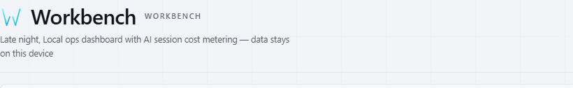
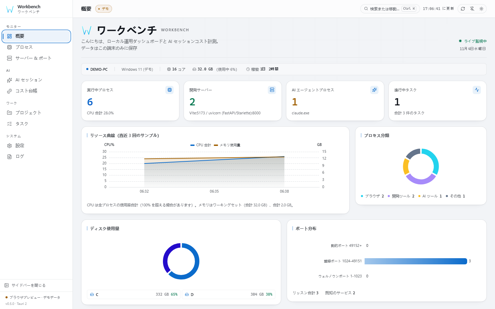
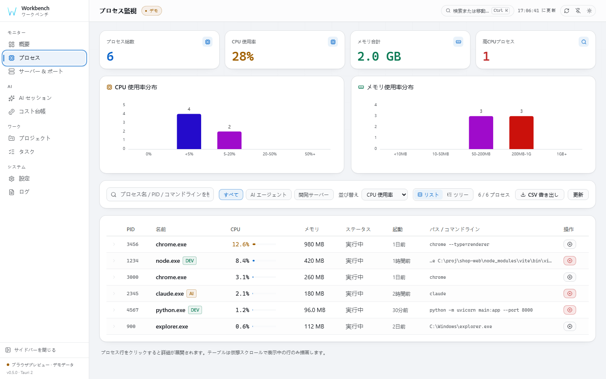
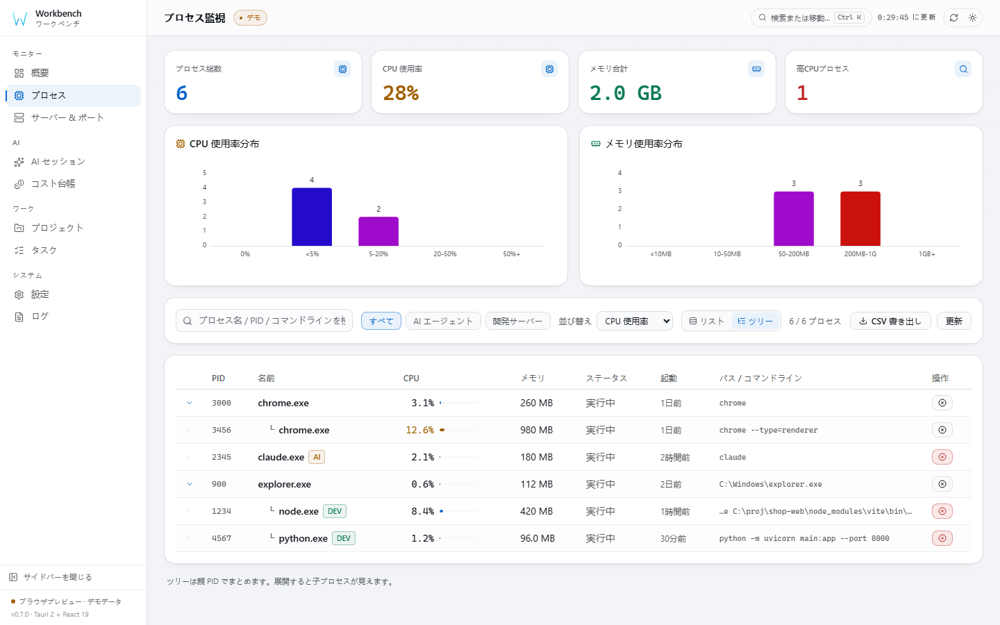
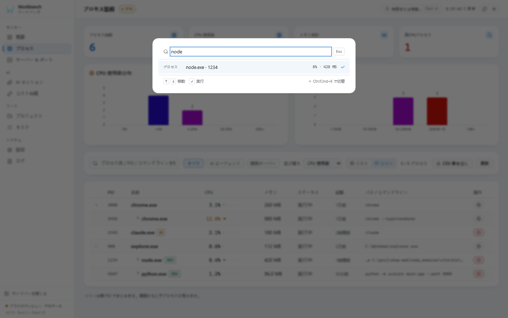
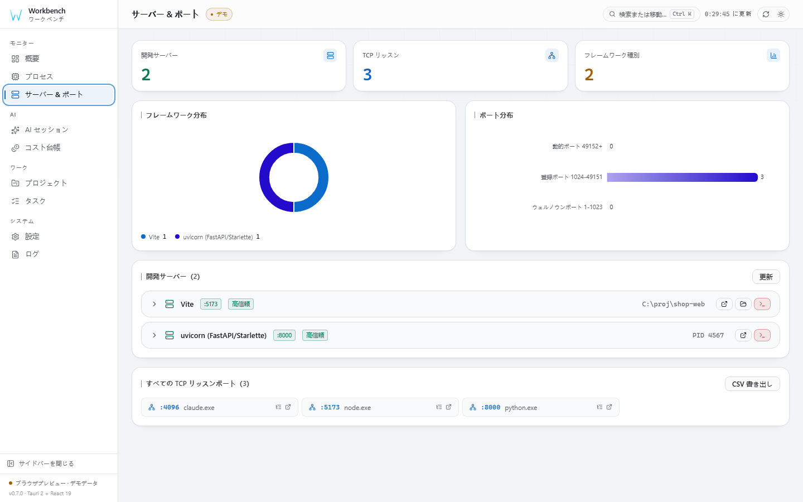
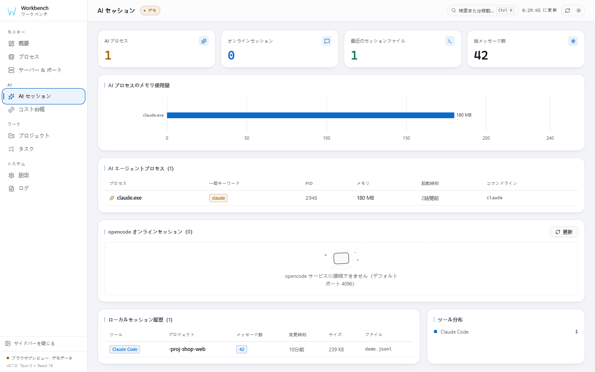
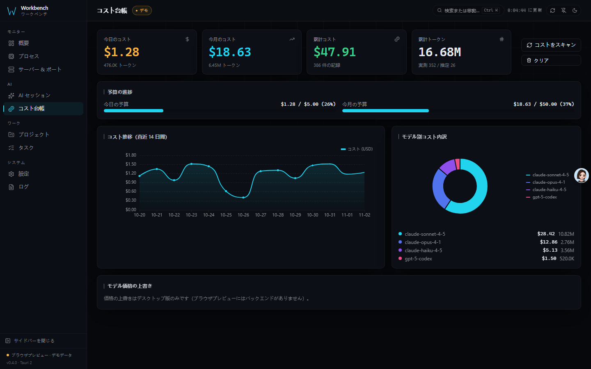
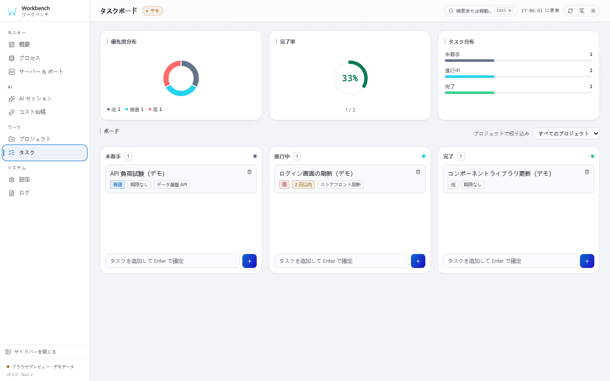

# Workbench

[English](README.md) | [简体中文](README.zh-CN.md) | **日本語**

[](CHANGELOG.md)
[](LICENSE)
[](docs/ARCHITECTURE.ja.md#システム要件)
[](#品質ゲート)



**ポートを見て、プロセスを見つけ、コストを把握する。**

自分のマシンでサービスや AI コーディングエージェントを動かす開発者のための、
ローカルファーストなデスクトップワークベンチ。プロセス・待受ポート・開発サーバー・
プロジェクト・タスク、そして Claude Code / Codex セッションが実際にいくら使ったかを
1 画面で把握できます。データは端末外に出ず、アカウントもクラウドもモデル設定も不要です。

## 他のツールとの違い

| | |
|---|---|
| **ポート → プロセス → コスト** | 待受ポートから所有プロセスへ直接移動でき、プロセスの詳細は保持している全ポートを逆引き表示。セッションファイルが同じマシンの作業と実コストを結びます。 |
| **開発サーバーを理解する** | 「ポートが開いている」だけでなく、コマンドラインから Vite / Next / Nuxt / Django / uvicorn / Rails など 30+ のフレームワークを信頼度付きで判定。 |
| **キーボード優先** | Ctrl/Cmd+K でページ・プロセス・ポート・プロジェクト・タスクを横断検索。フラット表と親子ツリーの 2 表示。 |
| **実装で担保する信頼性** | 保護対象プロセスは Rust 層で拒否、終了直前に同一性を再検証、昇格は都度承認。レポートには検証内容を明記。 |
| **誠実なローカルファースト** | 台帳はローカル SQLite、CSP は self 固定、テレメトリなし。外部通信は任意のローカル opencode 探索のみ。 |

## スクリーンショット

| 概要 | プロセス |
|------|----------|
|  |  |
| CPU / メモリ推移、ディスク、プロセス分類 | 全プロセス snapshot、仮想スクロール、CSV 書き出し |

| プロセスツリー | コマンドパレット |
|----------------|------------------|
|  |  |
| 親 PID でグループ化、子プロセスと待受ポート | Ctrl/Cmd+K でページ / プロセス / ポート / プロジェクト / タスクを検索 |

| サーバー & ポート | AI セッション |
|-------------------|----------------|
|  |  |
| netstat / ss 解析、開発フレームワーク判定 | セッションファイル、オンラインセッション、ツール分布 |

| コスト台帳 | タスク |
|------------|--------|
|  |  |
| 予算進捗、推移、モデル内訳 | ドラッグ＆ドロップのカンバン |

### 30 秒ツアー

[](docs/screenshots/workbench-demo.mp4)

ブラウザのデモモードで録画した実際の UI（実在のホスト名・パス・アカウント情報は含みません）。
[MP4 を直接ダウンロード](docs/screenshots/workbench-demo.mp4)。

## 機能

| 機能 | 説明 |
|------|------|
| **リアルタイム監視** | プロセス、待受ポート（Windows は `netstat`、Linux は `ss -tulpn` で netstat にフォールバック）、開発サーバー検出（フレームワーク + 信頼度） |
| **プロセスツリー** | リスト / 親子ツリーの 2 表示。`parent_pid` から構築し孤児・循環に安全。仮想スクロール、行内詳細（そのプロセスの待受ポート）、CSV 書き出し |
| **コマンドパレット** | Ctrl/Cmd+K でページ・プロセス・ポート・プロジェクト・タスクを曖昧検索。↑ ↓ ↵ Esc の完全キーボード操作 |
| **管理者として終了** | 通常終了が失敗したあとワンクリックで管理者終了——OS の UAC を提示。保護対象システムプロセスはバックエンドが事前拒否 |
| **AI セッションコスト計測** | ローカル Claude / Codex セッションのトークンコストを SQLite 台帳に記録——モデル不要・API キー不要・データは端末外に出ません |
| **価格エディタ** | 40+ モデルの価格を内蔵。UI から変更 / 追加 / 内蔵価格へ復元 |
| **バックアップ & 復元** | タイムスタンプ付きスナップショット、ワンクリック復元、整合性チェック（`VACUUM INTO` + `PRAGMA integrity_check`） |
| **ログイン時に起動** | 実際の OS 登録（レジストリ / autostart）。トグルは OS から状態を再読込 |
| **環境チェック** | プラットフォーム、データフォルダー、コスト DB、セッションフォルダー、ポートツールを ok / warn / fail で個別表示。レポートはコピー可能 |
| **CLI モード** | 同じ実行ファイルで `workbench ps` / `ports` / `diag`（`--json` 対応）。読み取り専用でスクリプト化可能、ウィンドウなし |
| **ビジュアルシステム** | 7 レイアウト × 8 テーマ × 3 シェル、ドラッグ / 非表示 + 個別幅設定、テーマエディタと共有リンク |
| **三言語 UI** | 简体中文（既定）/ English / 日本語 |
| **クロスプラットフォーム** | CI に Windows / Linux / macOS のジョブを定義。Linux `.deb` と macOS `.app` のビルドを含む |

## 品質ゲート

このリポジトリの主張は、コマンドで検証できるものだけです。ローカル
（`node scripts/ci-local.mjs`）と CI は同じ手順を実行します:

| ゲート | 検出するもの |
|--------|--------------|
| `npm run version:check` | 4 か所のバージョン番号のずれ |
| `npx tsc --noEmit` | 型エラー（生成された IPC 契約を含む） |
| `npm run lint` · `npm run format:check` | ESLint 警告ゼロ、Prettier 整形 |
| `npm run dup` | 重複コード 3% 超 |
| `npm run coverage` | フロントエンド 408 テスト、カバレッジ閾値付き |
| `cargo test` | バックエンド 131 テスト + ts-rs バインディング出力 |
| `cargo clippy -- -D warnings` | Rust lint、警告ゼロ |
| `npm audit` · `cargo audit` | 両方の依存ツリーの既知脆弱性 |
| `npm run test:e2e` | Playwright 28 ケース: 構造、WCAG AA コントラスト、視覚ベースライン |

## ダウンロード

利用可能なバージョンとアセットは Release ページで確認してください。リリースワークフローには
Windows NSIS、Linux `.deb`、macOS `.app` のビルドが設定されていますが、各プラットフォームの
アセットの公開や検証を保証するものではありません。

Release ページ:

| ミラー | Release ページ |
|--------|----------------|
| GitCode | [gitcode.com/badhope/workbench/releases](https://gitcode.com/badhope/workbench/releases) |
| Gitee | [gitee.com/badhope/workbench/releases](https://gitee.com/badhope/workbench/releases) |
| GitHub | [github.com/X33834/workbench/releases](https://github.com/X33834/workbench/releases) |

## ビルド

固定されたフロントエンド依存関係には Node.js `^22.22.2 || ^24.15.0 || >=26.0.0`、また Rust ≥ 1.90 が必要です:

```bash
npm install
npm run tauri dev      # デスクトップ開発モード（ホットリロード付き）
npm run tauri build    # インストーラー → src-tauri/target/release/bundle/
```

ローカル CI ミラー（`.github/workflows/ci.yml` と同じ手順）:

```bash
node scripts/ci-local.mjs          # 型 → lint → 整形 → 単体テスト → ビルド → Playwright → cargo
node scripts/ci-local.mjs --fast   # 視覚回帰をスキップ
```

コマンドライン（同じ実行ファイル、ウィンドウなし）:

```bash
workbench ps            # 全プロセス: PID、名前、CPU%、メモリ、親、状態
workbench ports         # 待受ポートと所有 PID
workbench diag          # 環境チェック
workbench ports --json  # スクリプト向け JSON
```

技術スタック・プロジェクト構成・FAQ・ロードマップ・スクリーンショット一覧などは
[アーキテクチャ & リファレンス](docs/ARCHITECTURE.ja.md)
（[English](docs/ARCHITECTURE.md) / [简体中文](docs/ARCHITECTURE.zh-CN.md)）へ。
Mission Center、System Informer、btop++、Glances、ccusage などとの比較は
[docs/COMPARISON.ja.md](docs/COMPARISON.ja.md)。

## コントリビュート & ライセンス

- 開発フロー: [CONTRIBUTING.md](CONTRIBUTING.md) · 脆弱性報告:
  [SECURITY.md](SECURITY.md) · 行動規範:
  [CODE_OF_CONDUCT.md](CODE_OF_CONDUCT.md) · 変更履歴:
  [CHANGELOG.md](CHANGELOG.md)
- [MIT](LICENSE) © 2026 x1882
