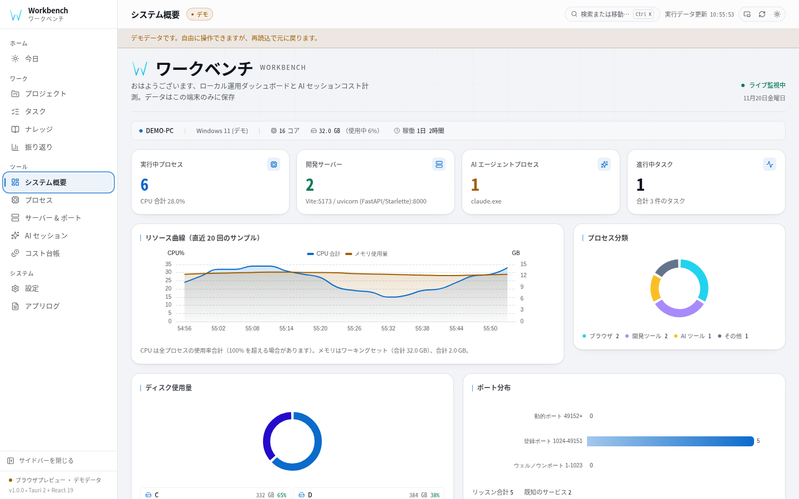

# Workbench

[English](README.md) | [简体中文](README.zh-CN.md) | **日本語**

[](CHANGELOG.md)
[](LICENSE)
[](docs/ARCHITECTURE.ja.md#システム要件)
[](#品質)



**毎日使っているこのマシンに、ローカル優先のワークベンチを。**

今日やるべきこと、プロジェクトとタスクの進み具合、ポートを使っているプロセス、
AI セッションのコストを 1 つのウィンドウにまとめます。アカウント不要、クラウド不要、
テレメトリーなし。データは端末の外に出ません。

## 使う理由

- **今日から始まる。** ホーム画面は「今、何をすべきか」だけを示します。期限切れ、
  今日まで、進行中、ブロック中、受信トレイ。プロジェクトには目標・進捗・次の一手があり、
  タスクには状態とブロック理由があります。フォルダの山ではなく、一日の流れが見えます。
- **ポートからプロセスへ。** 待ち受けポートは、それを保持するプロセスに直接つながります。
  プロセスの詳細では、そのプロセスが持つすべてのポートを確認できます。開発サーバーは
  フレームワーク別に表示されるので、どのターミナルで起動したかを推測する必要はありません。
- **AI の実際のコストを見る。** ローカルの Claude Code / Codex セッションファイルを
  SQLite の台帳にまとめ、モデル別の内訳、予算、14 日間の推移を表示します。
  元のファイルはその場に残ります。
- **ローカルの知識を手元に。** Markdown フォルダーをそのまま登録し、タイトル、本文、
  タグ、プロジェクトとの関連を検索できます。同じ文脈は MCP クライアントにも stdio で
  渡せます。書き込みは既定で無効です。
- **主導権は自分に。** データはこの端末にあります。外部への通信は、ローカルの
  opencode サービスを任意で確認するときだけです。

## 実行

[GitHub Releases](https://github.com/X33834/workbench/releases) からビルドを入手します。国内向けの [Gitee Releases](https://gitee.com/badhope/workbench/releases) と [GitCode Releases](https://gitcode.com/badhope/workbench/releases) も利用できます。またはソースから実行します。Windows は NSIS、Linux は `.deb` と AppImage、macOS は DMG を提供します。デスクトップ版は設定ページで署名済み `latest.json` を確認し、検証後に更新します。

```bash
npm ci
npm run tauri dev      # ホットリロード付きのデスクトップ開発
npm run tauri build    # インストーラーは src-tauri/target/release/bundle/ に出力
```

同じバイナリは、ウィンドウなしでも使えます。

| 形態 | コマンド | 得られるもの |
| --- | --- | --- |
| デスクトップ | ビルドをインストール | トレイ、グローバルショートカット、ミニウィンドウ、プロセス操作 |
| Web | `workbench serve` | `127.0.0.1:7788` で動くローカル UI と API。マシン状態は読み取り専用 |
| CLI | `workbench ps`、`ports`、`diag`、`cost`、`mcp` | スクリプト向け。JSON 出力に対応し、ウィンドウを開かない |

```bash
workbench ps              # PID、名前、CPU、メモリ、親プロセス、状態
workbench ports           # 待ち受けポートと所有 PID
workbench cost --days 7   # AI セッションのコスト
workbench serve           # Web UI と HTTP API
```

## 画面

| プロセス | サービスとポート |
| --- | --- |
|  |  |
| リアルタイムのプロセス、ポート、開発サーバーのタグ | 待ち受けポート、確立済み接続、フレームワーク検出 |

| コスト台帳 | AI セッション |
| --- | --- |
|  |  |
| 予算、モデル別内訳、14 日間の推移 | ローカルの Claude Code / Codex セッションと検出されたエージェント |

## 品質

リリースごとに TypeScript、ESLint、Prettier、Vitest、Rust テスト、Clippy、
Playwright の視覚テスト、`npm audit`、`cargo audit` を通しています。同じ手順は
`node scripts/ci-local.mjs` でローカル実行でき、CI の設定は
[GitHub Actions](.github/workflows/ci.yml) にあります。

## ドキュメント

- [アーキテクチャとリファレンス](docs/ARCHITECTURE.ja.md) ·
  [English](docs/ARCHITECTURE.md) · [简体中文](docs/ARCHITECTURE.zh-CN.md)
- [他ツールとの比較](docs/COMPARISON.ja.md) ·
  [English](docs/COMPARISON.md) · [简体中文](docs/COMPARISON.zh-CN.md)
- [ロードマップ](docs/ROADMAP.md) · [エンジニアリング境界 (中文)](docs/ENGINEERING.md)
- [コントリビュート](CONTRIBUTING.md) · [セキュリティ](SECURITY.md) ·
  [行動規範](CODE_OF_CONDUCT.md) · [変更履歴](CHANGELOG.md)

## ライセンス

[MIT](LICENSE) © 2026 x1882
