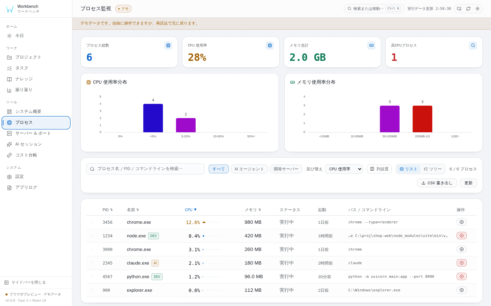
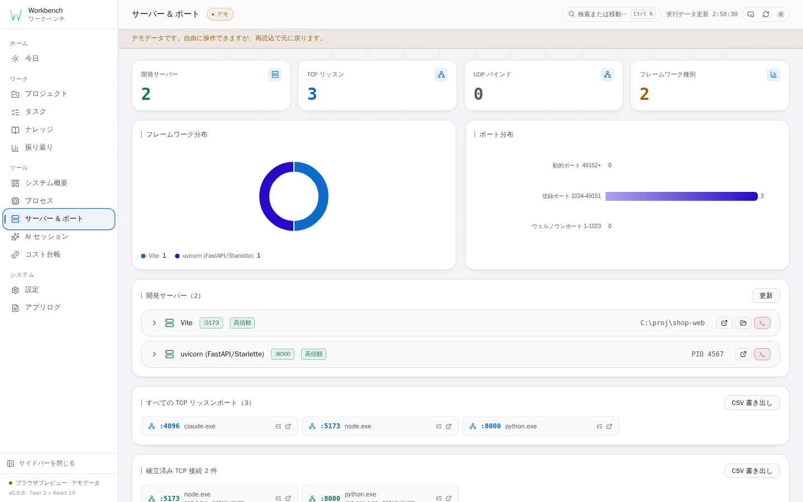
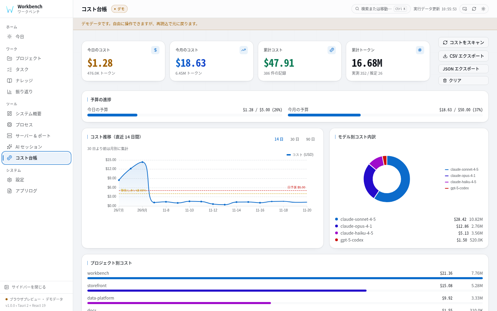
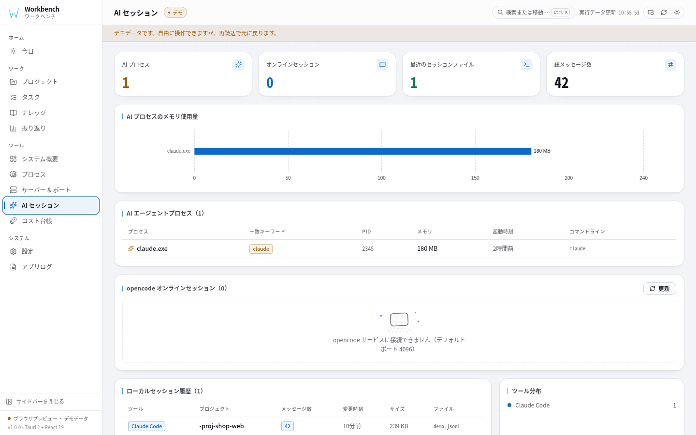

# Workbench

[English](README.md) | [简体中文](README.zh-CN.md) | **日本語**

[](CHANGELOG.md)
[](LICENSE)
[](docs/ARCHITECTURE.ja.md#システム要件)
[](https://github.com/X33834/workbench/actions/workflows/ci.yml)


毎日使っているこのマシンに、ローカル優先のワークベンチを。タスク、プロジェクト、待ち受けポート、プロセス、AI の利用コスト、ノートを 1 つのウィンドウにまとめます。Workbench アカウントもテレメトリーもありません。設定したモデル端点だけが端末の外に出ることがあります。

## できること

- **今日やることを見る。** 期限切れ、今日まで、進行中のプロジェクト、ブロック中、受信トレイを 1 画面で確認できます。
- **ポートからプロセスへ。** 待ち受けポートは所有プロセスに直接つながり、プロセスの詳細では保持している全ポートを確認できます。開発サーバーはフレームワーク別に表示されます。
- **AI の実際のコストを見る。** ローカルの Claude Code / Codex セッションファイルを SQLite の台帳にまとめ、予算とモデル別の内訳を表示します。
- **ノートを手元に。** Markdown フォルダーをそのまま登録し、タイトル、本文、タグ、関連プロジェクトを検索できます。同じ文脈は MCP クライアントにも stdio で渡せます。
- **自分のモデルに聞く。** 任意のアシスタントはタスク、ポート、コスト、ノートを先に調べてから答えます。タスク作成は書き込みスイッチを有効にしたときだけです。

## 実行

[GitHub Releases](https://github.com/X33834/workbench/releases) からビルドを入手できます。国内向けの [Gitee](https://gitee.com/badhope/workbench/releases) と [GitCode](https://gitcode.com/badhope/workbench/releases) も利用できます。Windows は NSIS、Linux は `.deb` と AppImage、macOS は DMG を提供します。

```bash
npm ci
npm run tauri dev      # ホットリロード付きのデスクトップ開発
npm run tauri build    # インストーラーは src-tauri/target/release/bundle/ に出力
```

同じバイナリはウィンドウなしでも使えます。

```bash
workbench ps              # プロセス
workbench ports           # 待ち受けポートと所有 PID
workbench cost --days 7   # AI セッションのコスト
workbench serve           # ローカル Web UI と HTTP API
workbench mcp             # stdio MCP サーバー
```

## 画面

| プロセス | サービスとポート |
| --- | --- |
|  |  |
| リアルタイムのプロセスとポート | 待ち受けポートと所有プロセス |

| コスト台帳 | AI セッション |
| --- | --- |
|  |  |
| 予算とモデル別内訳 | ローカルの Claude Code / Codex セッション |

## 品質

リリースごとに TypeScript、ESLint、Prettier、Vitest、Rust テスト、Clippy、
Playwright の視覚チェック、`npm audit`、`cargo audit` を通しています。同じ手順は
`node scripts/ci-local.mjs` でローカル実行でき、CI の設定は
[GitHub Actions](.github/workflows/ci.yml) にあります。

## ドキュメント

- [ドキュメント索引](docs/README.md)
- [アーキテクチャ](docs/ARCHITECTURE.ja.md) · [English](docs/ARCHITECTURE.md)
- [他ツールとの比較](docs/COMPARISON.ja.md) · [English](docs/COMPARISON.md)
- [エンジニアリング境界](docs/ENGINEERING.md) · [ロードマップ](docs/ROADMAP.md)
- [コントリビュート](CONTRIBUTING.md) · [セキュリティ](SECURITY.md) · [変更履歴](CHANGELOG.md)

## ライセンス

[MIT](LICENSE) © 2026 x1882
</content>
