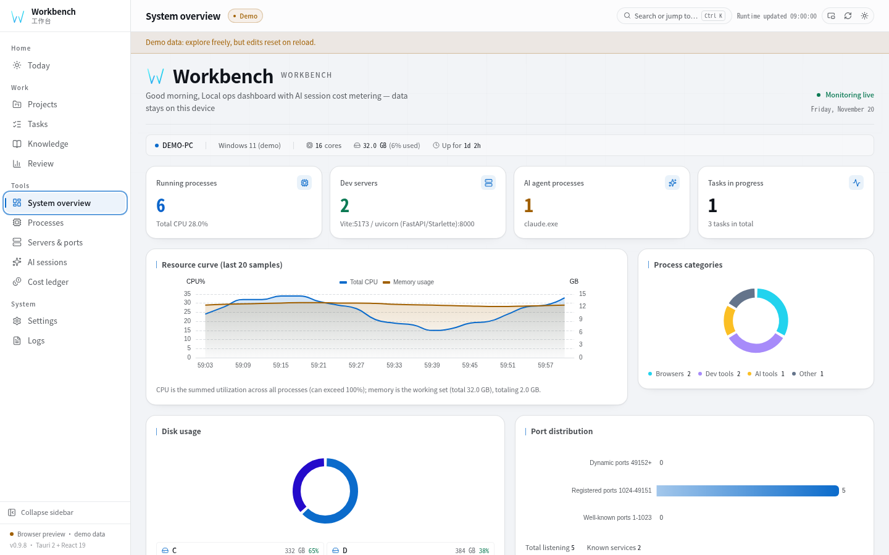
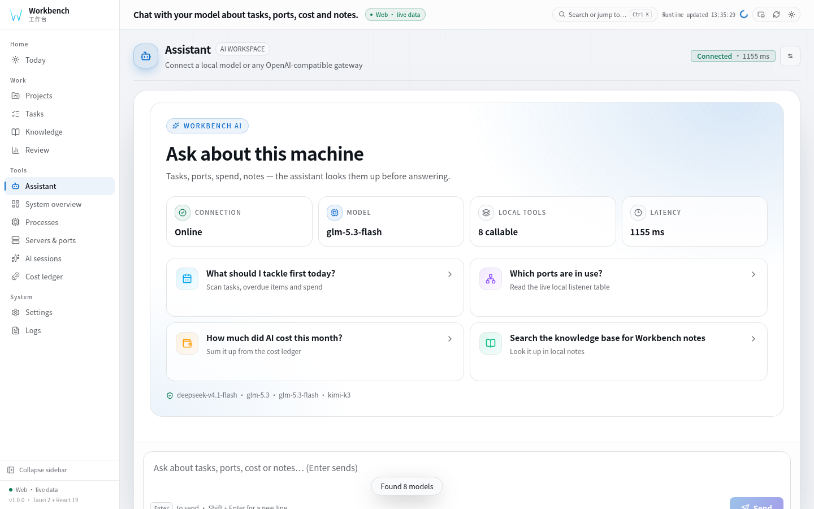

# Workbench

English | [简体中文](README.zh-CN.md)

[](CHANGELOG.md)
[](LICENSE)
[](docs/ARCHITECTURE.md#system-requirements)
[](https://github.com/X33834/workbench/actions/workflows/ci.yml)



A local-first desktop workbench for the machine you actually work on. It keeps today's tasks, projects, listening ports, running processes, AI session spend, and local notes in one window. No account, no telemetry.

## What it does

- **Today, not a folder tree.** See overdue work, tasks due today, active projects, blockers, and the inbox on one screen.
- **Follow a port to its process.** Listening ports link to the process that owns them; processes show every port they hold. Dev servers are tagged by framework.
- **See what AI work costs.** Local Claude Code and Codex session files are priced into a SQLite ledger, with budgets and a model breakdown.
- **Keep notes close.** Mount Markdown folders in place and search titles, body, tags, and linked projects. The same context is available to MCP clients over stdio.
- **Ask your own model.** The optional assistant reads live tasks, ports, spend, and notes before answering. It can create tasks only when the write switch is enabled.

## Run it

Download a build from [GitHub Releases](https://github.com/X33834/workbench/releases). Windows ships NSIS, Linux ships `.deb` and AppImage, macOS ships a DMG.

The Gitee and GitCode mirrors also keep the same installers offline: [Gitee downloads](https://gitee.com/badhope/workbench/tree/main/downloads/v1.0.0) · [GitCode downloads](https://gitcode.com/badhope/workbench/tree/main/downloads/v1.0.0).

```bash
npm ci
npm run tauri dev      # desktop app with hot reload
npm run tauri build    # installers in src-tauri/target/release/bundle/
```

The same binary runs without a window:

```bash
workbench ps              # processes
workbench ports           # listening ports and owning PID
workbench cost --days 7   # AI session spend
workbench serve           # local web UI and HTTP API
workbench mcp             # MCP server over stdio
```

## Assistant

The assistant is optional. Point it at a local OpenAI-compatible server or a remote HTTPS gateway in Settings. It uses deterministic local tools for tasks, ports, costs, dates, arithmetic, and knowledge search, then asks the model to summarize the real results.

## A look inside

[▶ Watch the UI tour](docs/screenshots/workbench-tour.mp4)

| Today | Assistant |
| --- | --- |
|  |  |
| What needs attention now | Ask about tasks, ports, spend, and notes |

| Servers & ports | Cost ledger |
| --- | --- |
|  |  |
| Listening ports and their owners | AI spend by model and budget |

## Quality

Every release runs TypeScript, ESLint, Prettier, Vitest, Rust tests, Clippy, Playwright visual checks, `npm audit`, and `cargo audit`. The same steps run locally with `node scripts/ci-local.mjs` and in [GitHub Actions](.github/workflows/ci.yml).

## Documentation

- [Documentation index](docs/README.md)
- [Architecture](docs/ARCHITECTURE.md) · [简体中文](docs/ARCHITECTURE.zh-CN.md)
- [Comparison](docs/COMPARISON.md) · [简体中文](docs/COMPARISON.zh-CN.md)
- [Engineering boundaries](docs/ENGINEERING.md) · [Roadmap](docs/ROADMAP.md)
- [Contributing](CONTRIBUTING.md) · [Security](SECURITY.md) · [Changelog](CHANGELOG.md)

## License

[MIT](LICENSE) © 2026 x1882
</content>
