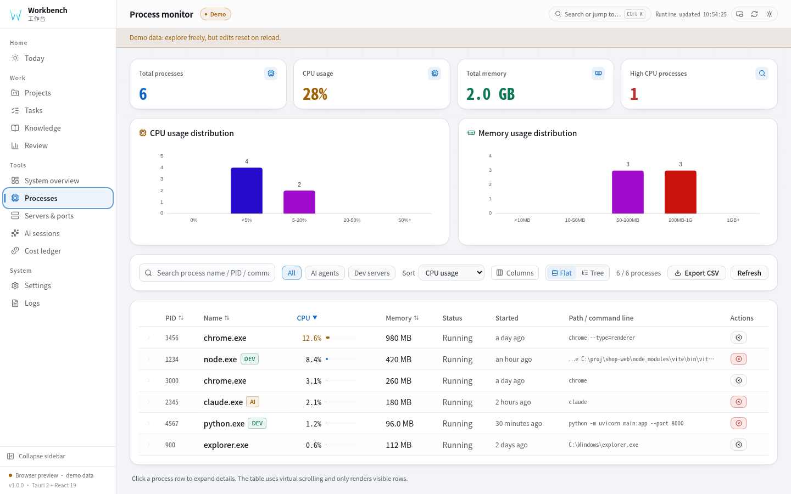
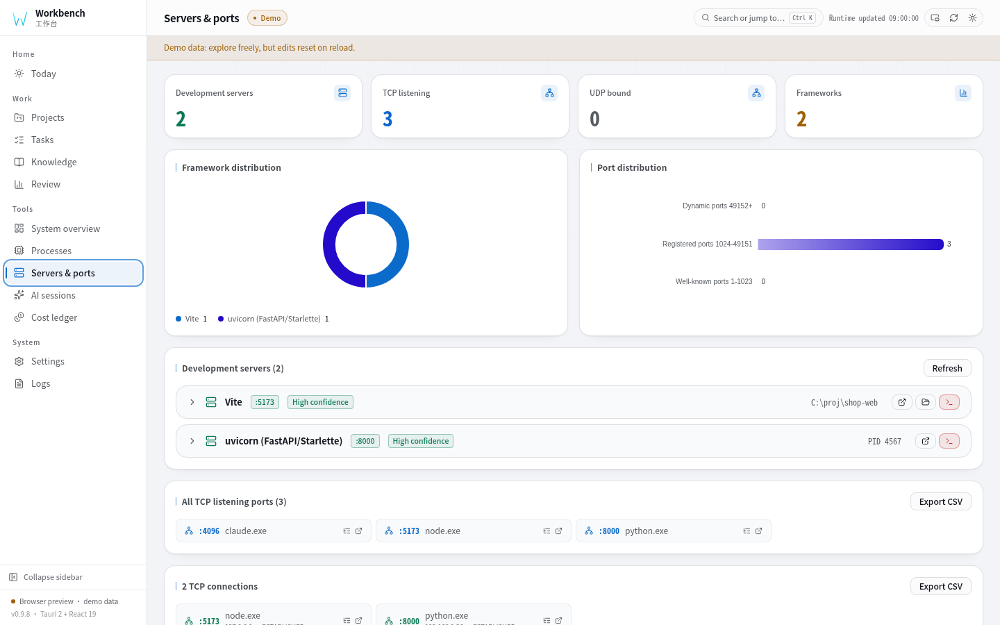
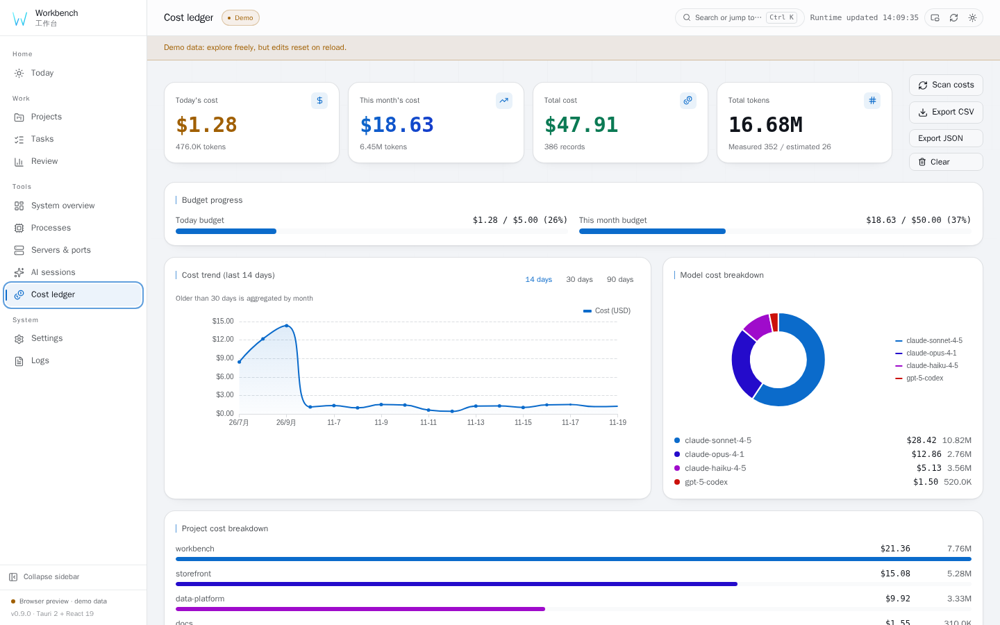
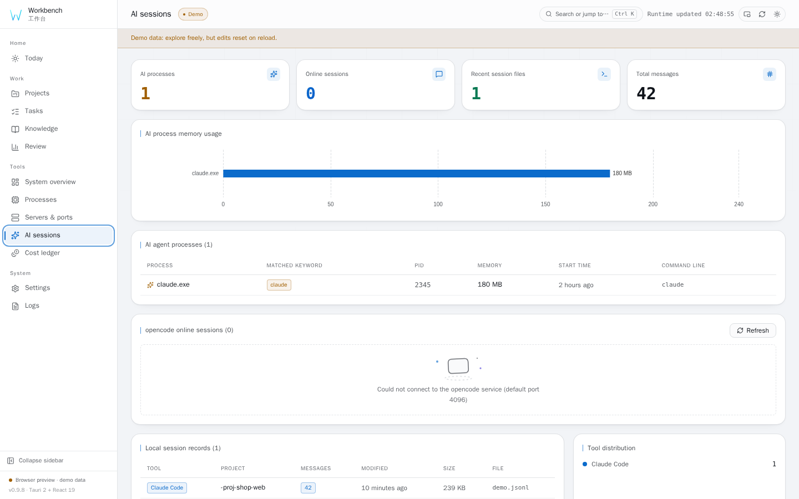

# Workbench

**English** | [简体中文](README.zh-CN.md) | [日本語](README.ja.md)

[](CHANGELOG.md)
[](LICENSE)
[](docs/ARCHITECTURE.md#system-requirements)
[](#quality)


**A local-first workbench for the machine you actually work on.**

It brings today's tasks, project progress, listening ports, running processes and
AI session spend into one window. No account, no cloud, no telemetry.

## Why Workbench

- **Start with today.** The home screen shows what needs attention now: overdue,
  due today, in progress, blocked and inbox. Projects and tasks carry a goal,
  progress and a next step, so the day has a shape instead of a list of folders.
- **Follow a port to its process.** A listening port links to the process that
  owns it, and a process shows every port it holds. Dev servers are recognised
  by framework. No guessing which terminal started what.
- **See what AI work costs.** Local Claude Code and Codex session files are
  priced into a SQLite ledger, with model breakdown, budgets and a 14-day trend.
  The files stay where they are.
- **Keep local knowledge close.** Mount Markdown folders in place and search
  titles, body, tags and project links. The same context is available to MCP
  clients over stdio, with writes off by default.
- **Stay in control.** Data lives on this device. The only outbound request is
  the optional probe of a local opencode server.

## Run it

Install a build from [Releases](../../releases), or run from source:

```bash
npm ci
npm run tauri dev      # desktop with hot reload
npm run tauri build    # installers in src-tauri/target/release/bundle/
```

The same binary works without a window:

| Mode | Command | What you get |
| --- | --- | --- |
| Desktop | install a bundle | Full app: tray, global shortcut, mini window, process actions |
| Web | `workbench serve` | The local UI and API on `127.0.0.1:7788`; machine state is read-only |
| CLI | `workbench ps`, `ports`, `diag`, `cost`, `mcp` | Scriptable JSON-friendly output; no window |

```bash
workbench ps              # pid, name, cpu, memory, parent, status
workbench ports           # listening ports with the owning pid
workbench cost --days 7   # AI session spend
workbench serve           # web UI and HTTP API
```

## A look inside

| Processes | Servers & ports |
| --- | --- |
|  |  |
| Live processes, ports and dev-server tags | Listening ports, established connections and framework detection |

| Cost ledger | AI sessions |
| --- | --- |
|  |  |
| Budgets, model split and 14-day trend | Local Claude Code / Codex sessions and detected agents |

## Quality

Every release is checked by TypeScript, ESLint, Prettier, Vitest, Rust tests,
Clippy, Playwright visual tests, `npm audit` and `cargo audit`. The same steps
run locally through `node scripts/ci-local.mjs` and in
[GitHub Actions](.github/workflows/ci.yml).

## Documentation

- [Architecture and reference](docs/ARCHITECTURE.md) ·
  [简体中文](docs/ARCHITECTURE.zh-CN.md) · [日本語](docs/ARCHITECTURE.ja.md)
- [How it compares](docs/COMPARISON.md) ·
  [简体中文](docs/COMPARISON.zh-CN.md) · [日本語](docs/COMPARISON.ja.md)
- [Roadmap](docs/ROADMAP.md) · [Engineering boundaries (中文)](docs/ENGINEERING.md)
- [Contributing](CONTRIBUTING.md) · [Security](SECURITY.md) ·
  [Code of conduct](CODE_OF_CONDUCT.md) · [Changelog](CHANGELOG.md)

## License

[MIT](LICENSE) © 2026 x1882
