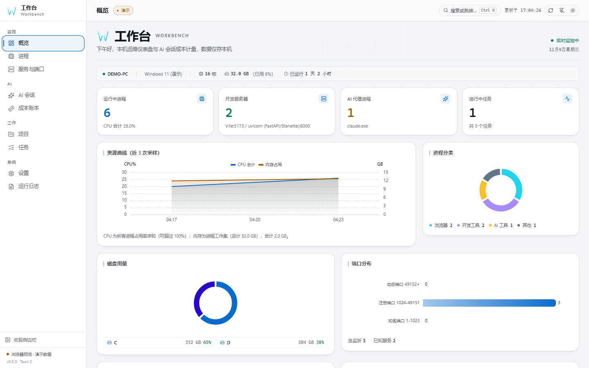
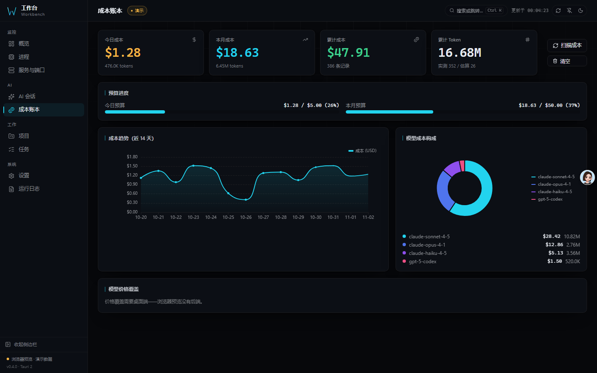
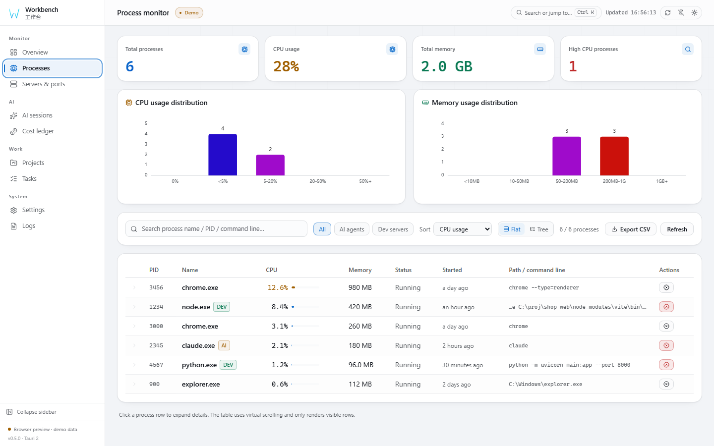
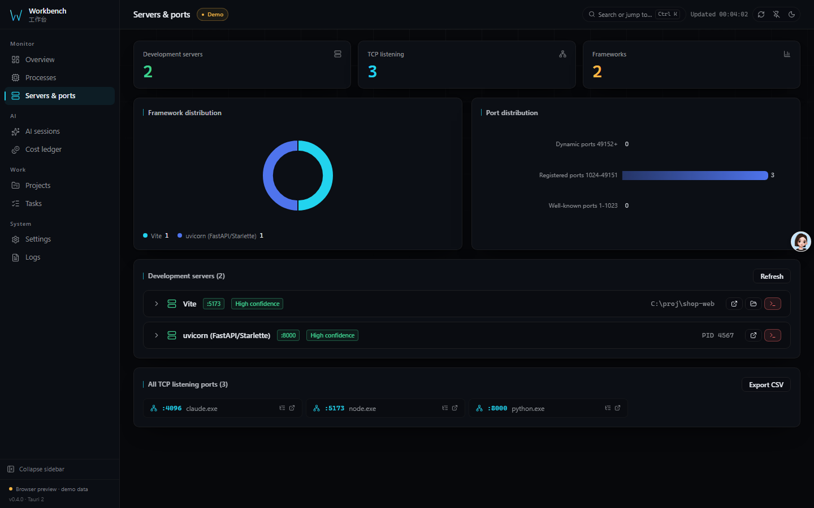
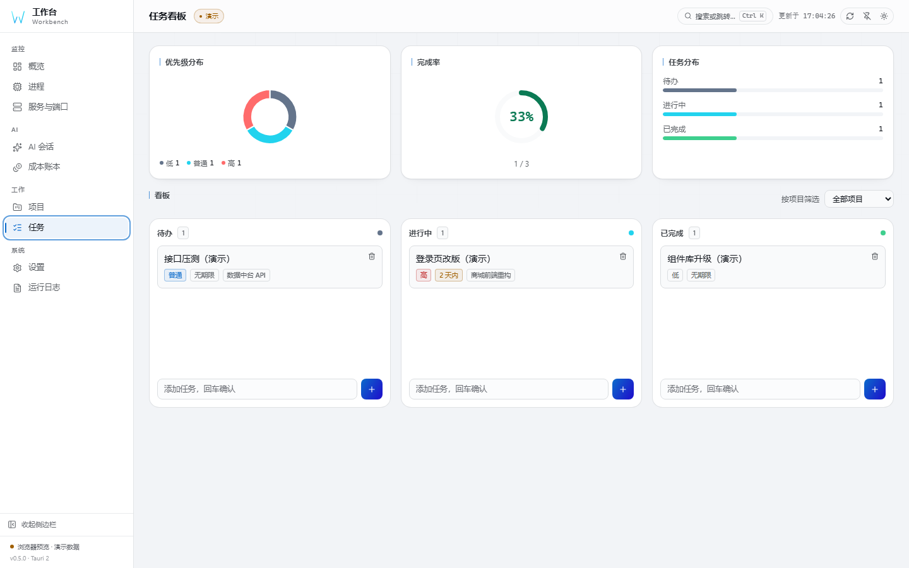
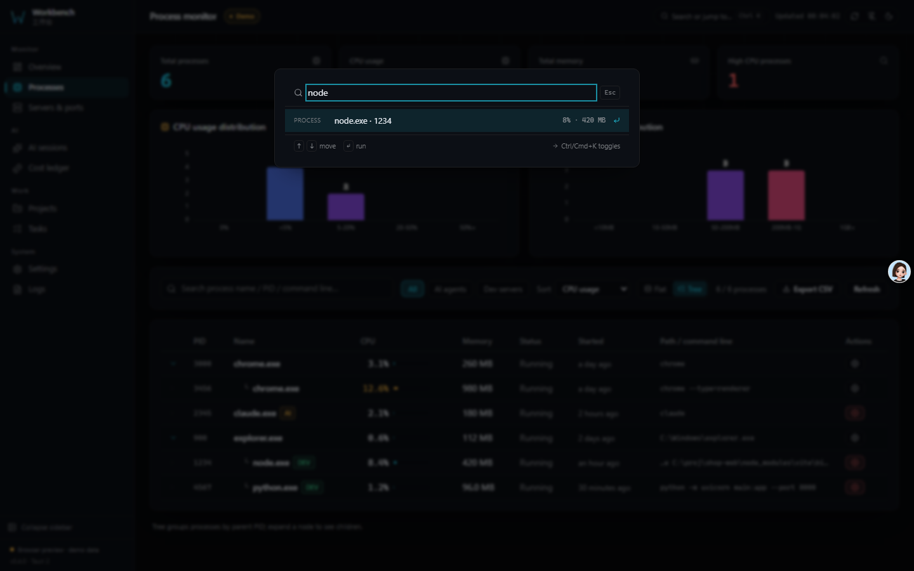

# Workbench

**English** | [简体中文](README.zh-CN.md) | [日本語](README.ja.md)

[](CHANGELOG.md)
[](LICENSE)
[](docs/ARCHITECTURE.md#system-requirements)
[](#quality-gates)


**See the port. Find the process. Know the cost. Finish the work.**

A local-first desktop workbench for people who run services and AI coding agents on
their own machine. One window shows today's work, every project and task, each
listening port and its process, and what Claude Code / Codex sessions actually cost.
Data never leaves the device — no account, no cloud, no model to configure.

## What makes it different

| | |
|---|---|
| **Today first** | The home screen answers "what should I do now" — overdue, due today, in-progress, blocked and inbox at a glance — not a wall of CPU gauges. |
| **Port → process → cost** | A listening port links to the process that owns it, and a process shows every port it holds. Session files connect the same machine's work to real spend. No other local tool joins those three views. |
| **Projects, not folders** | A project has a goal, progress and next action. Tasks carry status, priority, due date, next step and blocked reason. The local folder is metadata, not identity. |
| **Keyboard-first** | Ctrl/Cmd+K searches pages, processes, ports, projects and tasks, then lands you inside the result — filtered to the project, focused on the task. |
| **Local-first, honestly** | SQLite ledger on your disk, CSP locked to `self`, no telemetry. The only outbound request is the optional probe of a local opencode server. |

## Three ways to run it

| Mode | Start it | What you get |
|------|----------|--------------|
| **Desktop** | install the bundle, or `npm run tauri dev` | The full app: tray, global shortcut, mini window, elevated kill, native notifications |
| **Web** | `workbench serve` | The same backend over HTTP on `127.0.0.1:7788`, serving the built UI to your browser. Real data, not demo. Machine state is read-only; kill and log-clear stay desktop-only |
| **Demo** | open the deployed landing page | Static sample data so the UI can be evaluated without installing anything |

The header badge always says which one you are looking at — `Live`, `Web · live data`
or `Demo` — so a number on screen is never ambiguous about being real.

## Screenshots

| Today (workbench) | Review |
|----------|--------|
|  |  |
| Current project, today list, quick capture, attention chips | Completion trend, project progress, status & priority split |

| Processes | Servers & ports |
|----------|-----------|
|  |  |
| Flat / tree view, virtual scrolling, CSV export | netstat / ss parsing, dev-framework tags |

| Cost ledger | Tasks |
|-------------|-------|
|  |  |
| Budget progress, trend, model split | List + kanban, status & blocked markers |

| Command palette | Mini window |
|--------------|-----------------|
|  |  |
| Ctrl/Cmd+K across pages, processes, ports, projects, tasks | Current work + today + quick capture, always on top |

## Features

| Feature | What you get |
|---------|--------------|
| **Workbench home** | Overdue / today / doing / blocked / inbox counts; current project with goal, progress ring and next step; quick capture to inbox |
| **Projects & tasks** | Projects with goal, status and progress; tasks with status, priority, due date, next step, blocked reason and completion timestamp; list + kanban views; keyboard and pointer workflows |
| **Monitoring** | Live processes, listening ports (`netstat` on Windows, `ss -tulpn` on Linux with a netstat fallback) and dev-server detection with framework + confidence |
| **Process tree** | Flat table or parent/child tree from `parent_pid`; orphan and cycle-safe, virtual scrolling, per-row detail with the process's own listening ports, CSV export |
| **Command palette** | Ctrl/Cmd+K fuzzy search over pages, processes, ports, projects and tasks; lands filtered on the project or focused on the task detail |
| **AI cost metering** | Token costs of local Claude / Codex sessions in a SQLite ledger — no model, no API key, nothing leaves your machine |
| **Review** | Completion trend (14-day), project progress, status and priority distribution — all computed from real data, with honest disclosure of what lacks history |
| **Pricing editor** | 40+ built-in model prices; edit / add / reset overrides from the UI |
| **Backup & restore** | Timestamped snapshots with one-click rollback and integrity checks (`VACUUM INTO` + `PRAGMA integrity_check`) |
| **Mini window** | A compact always-on-top companion showing current project, today's tasks and quick capture; syncs with the main window via BroadcastChannel |
| **Start at login** | Real OS registration (registry / autostart entry), toggle reads back from the OS |
| **Environment check** | Per-item ok / warn / fail report for platform, data directory, cost DB, session folders and port tools, with a copyable summary |
| **CLI mode** | One binary: `ps` / `ports` / `diag` / `cost` / `serve` (all support `--json`); scriptable, no window |
| **Visual system** | 7 overview layouts × 16 themes × 3 shells, draggable & hideable widgets with per-widget widths, theme editor with share links |
| **Trilingual UI** | 简体中文 (default) / English / 日本語 |
| **Cross-platform** | CI defines Windows, Linux and macOS jobs, including Linux `.deb` and macOS `.app` builds |

## Quality gates

Every claim in this README is verified by a command. The same steps run locally
(`node scripts/ci-local.mjs`) and in CI:

| Gate | What it catches |
|------|-----------------|
| `npm run version:check` | the four version files drifting apart |
| `npx tsc --noEmit` | type errors, including the generated IPC contract |
| `npm run lint` · `npm run format:check` | zero-warning ESLint, Prettier |
| `npm test` | **575** frontend tests with an enforced threshold |
| `cargo test --lib` | **172** backend tests, plus the ts-rs binding export |
| `npm run test:e2e` | **25** Playwright cases: navigation, WCAG AA contrast, visual baselines |
| `cargo clippy -- -D warnings` | Rust lints, zero tolerated |
| `npm audit` · `cargo audit` | known vulnerabilities in either dependency tree |

## Build

Requires Node.js `^22.22.2 || ^24.15.0 || >=26.0.0` and Rust ≥ 1.90:

```bash
npm install
npm run tauri dev      # desktop dev mode (hot reload)
npm run tauri build    # installers → src-tauri/target/release/bundle/
```

Local CI mirror (same steps as `.github/workflows/ci.yml`):

```bash
node scripts/ci-local.mjs          # typecheck → lint → format → unit → build → Playwright → cargo
node scripts/ci-local.mjs --fast   # skip the visual-regression pass
```

Command line (same executable, no window):

```bash
workbench ps              # every process: pid, name, cpu%, memory, parent, status
workbench ports           # listening TCP/UDP ports with the owning PID
workbench diag            # environment self-check
workbench cost            # AI session cost summary (--days N, --by-project)
workbench serve           # headless HTTP API + web UI on 127.0.0.1:7788
workbench ports --json    # machine-readable output for scripts
```

Tech stack, project structure, FAQ and everything else live in
the [architecture & reference doc](docs/ARCHITECTURE.md)
([简体中文](docs/ARCHITECTURE.zh-CN.md) / [日本語](docs/ARCHITECTURE.ja.md)).

## Contributing & License

- Contribution workflow: [CONTRIBUTING.md](CONTRIBUTING.md) · Security:
  [SECURITY.md](SECURITY.md) · Conduct: [CODE_OF_CONDUCT.md](CODE_OF_CONDUCT.md) ·
  Changelog: [CHANGELOG.md](CHANGELOG.md)
- [MIT](LICENSE) © 2026 x1882
