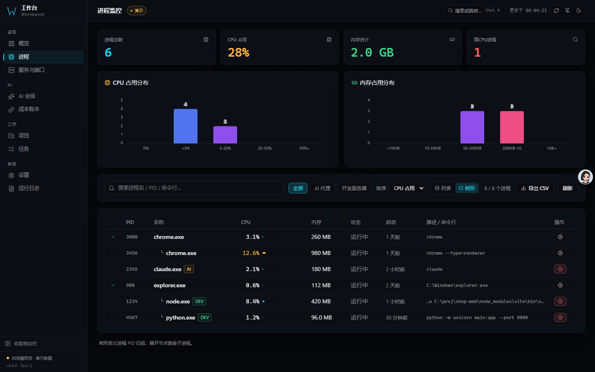
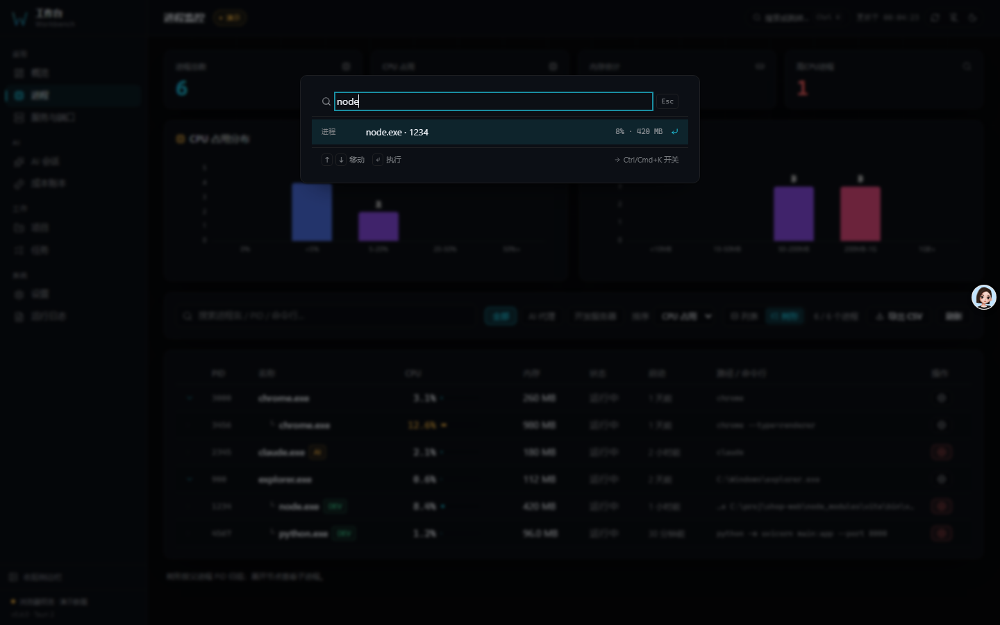
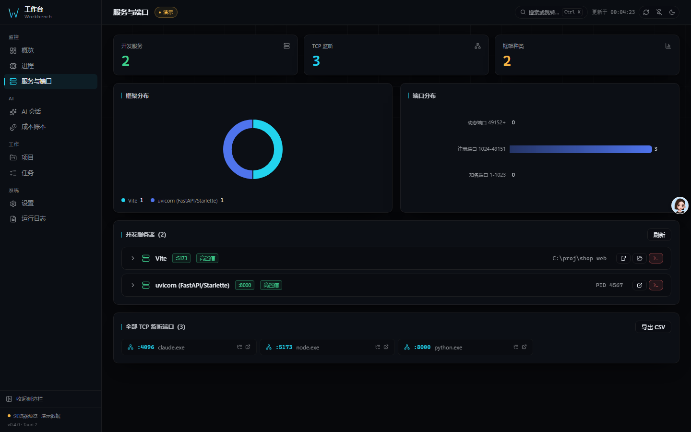
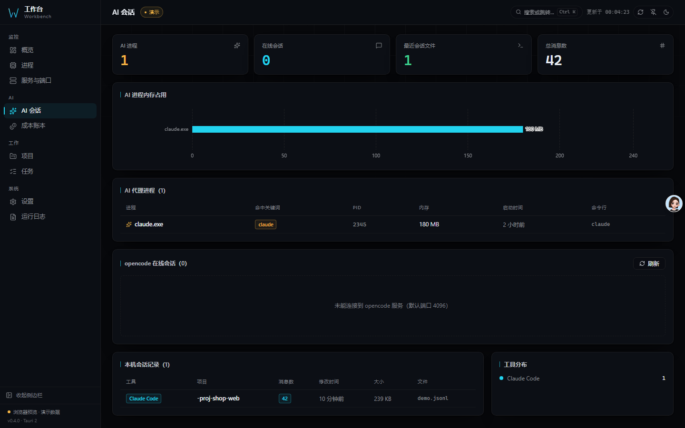

# 工作台 Workbench

[English](README.md) | **简体中文** | [日本語](README.ja.md)

[](CHANGELOG.md)
[](LICENSE)
[](docs/ARCHITECTURE.zh-CN.md#系统要求)
[](#质量门禁)


**看见端口，找到进程，算清成本。**

面向在本机跑服务、跑 AI 编码代理的开发者：一屏看清所有进程、监听端口、开发服务器、
项目与任务，以及 Claude Code / Codex 会话到底花了多少钱。数据不出本机，没有账号、
没有云端、不需要配置模型。

## 与同类工具的不同

| | |
|---|---|
| **端口 → 进程 → 成本** | 从监听端口一键跳到占用它的进程，进程详情反过来列出它持有的全部端口；会话文件把同一台机器上的工作和真实花费连起来。同类本地工具没有把这三层接在一起。 |
| **懂开发服务器** | 不止「端口开着」：从命令行识别 Vite / Next / Nuxt / Django / uvicorn / Rails 等 30+ 框架，并标注置信度。 |
| **键盘优先** | Ctrl/Cmd+K 一次搜索页面、进程、端口、项目、任务；进程支持列表与父子树双视图，全流程不用鼠标。 |
| **可靠性写进实现** | 受保护系统进程在 Rust 层直接拒绝；结束前重新校验目标身份；提权按次授权；每份报告都写清它验证了什么。 |
| **诚实的本地优先** | 账本是本机 SQLite，CSP 收紧到 self，无遥测。唯一的外部请求是可选地探测本机 opencode 服务。 |

## 界面预览

| 概览 | 进程监控 |
|------|----------|
|  |  |
| CPU / 内存趋势、磁盘与进程分类 | 全进程快照、虚拟滚动、CSV 导出 |

| 进程树 | 命令面板 |
|--------|----------|
|  |  |
| 按父 PID 归组，展开看子进程与端口 | Ctrl/Cmd+K 横跨页面 / 进程 / 端口 / 项目 / 任务 |

| 服务与端口 | AI 会话 |
|------------|----------|
|  |  |
| netstat / ss 解析与开发框架标注 | 会话文件、在线会话、工具分布 |

| 成本账本 | 任务看板 |
|----------|----------|
|  |  |
| 预算进度、趋势、模型分解 | 拖拽看板，待办 / 进行中 / 已完成 |

### 30 秒演示

[](docs/screenshots/workbench-demo.mp4)

浏览器演示模式下录制的真实界面（不含任何真实主机名、路径或账户数据）。
[直接下载 MP4](docs/screenshots/workbench-demo.mp4)。

## 功能

| 功能 | 说明 |
|------|------|
| **实时监控** | 进程、监听端口（Windows 用 `netstat`，Linux 用 `ss -tulpn` 并回退 netstat）、开发服务器识别（框架 + 置信度） |
| **进程树** | 列表 / 父子树双视图，基于 `parent_pid` 构建且对孤儿与环安全；虚拟滚动、行内详情（含该进程自己的监听端口）、CSV 导出 |
| **命令面板** | Ctrl/Cmd+K 模糊搜索页面、进程、端口、项目、任务；↑ ↓ ↵ Esc 全键盘操作 |
| **管理员结束进程** | 普通结束失败后一键「以管理员结束」，触发系统 UAC 授权弹窗；受保护系统进程由后端先行拦截 |
| **AI 会话成本计量** | 本机 Claude / Codex 会话 token 成本，SQLite 本地账本——不依赖任何模型、不要 API key、数据不出本机 |
| **价格编辑器** | 40+ 模型价格内置，界面内改价 / 新增 / 恢复内置价 |
| **备份恢复** | 带时间戳快照，一键回滚，恢复前完整性校验（`VACUUM INTO` + `PRAGMA integrity_check`） |
| **开机自启** | 真实系统级注册（注册表 / autostart），开关状态回读操作系统 |
| **环境自检** | 平台、数据目录、成本库、会话目录、端口工具逐项 ok / warn / fail，报告可一键复制 |
| **命令行模式** | 同一个可执行文件支持 `workbench ps` / `ports` / `diag`（加 `--json`），只读、可进脚本、不弹窗口 |
| **视觉系统** | 7 种概览版面 × 8 套主题 × 3 种外壳，组件可拖拽 / 隐藏并单独设宽度，主题编辑器与分享链接 |
| **三语界面** | 简体中文（默认）/ English / 日本語 |
| **跨平台** | CI 定义了 Windows、Linux 和 macOS 的任务，包括 Linux `.deb` 与 macOS `.app` 构建 |

## 质量门禁

仓库里没有任何一条声明是没被命令验证过的。本地（`node scripts/ci-local.mjs`）
与 CI 跑的是同一套步骤：

| 门禁 | 拦截什么 |
|------|----------|
| `npm run version:check` | 四处版本号互相漂移 |
| `npx tsc --noEmit` | 类型错误，含生成的 IPC 契约 |
| `npm run lint` · `npm run format:check` | ESLint 零告警、Prettier 格式 |
| `npm run dup` | 重复代码超过 3% |
| `npm run coverage` | 408 个前端测试，带覆盖率阈值 |
| `cargo test` | 131 个后端测试，以及 ts-rs 绑定导出 |
| `cargo clippy -- -D warnings` | Rust lint，零容忍 |
| `npm audit` · `cargo audit` | 两套依赖树中的已知漏洞 |
| `npm run test:e2e` | 28 个 Playwright 用例：结构、WCAG AA 对比度、视觉基线 |

## 下载

请在 Release 页面查看可用版本和附件。发布工作流配置了 Windows NSIS、Linux `.deb`
和 macOS `.app` 构建，但这并不代表各平台附件均已发布或验证。

Release 页面：

| 镜像 | Release 页 |
|------|------------|
| GitCode | [gitcode.com/badhope/workbench/releases](https://gitcode.com/badhope/workbench/releases) |
| Gitee | [gitee.com/badhope/workbench/releases](https://gitee.com/badhope/workbench/releases) |
| GitHub | [github.com/X33834/workbench/releases](https://github.com/X33834/workbench/releases) |

## 构建

锁定的前端依赖需要 Node.js `^22.22.2 || ^24.15.0 || >=26.0.0`，并需要 Rust ≥ 1.90：

```bash
npm install
npm run tauri dev      # 桌面开发模式（含热更新）
npm run tauri build    # 安装包 → src-tauri/target/release/bundle/
```

本地 CI 镜像（与 `.github/workflows/ci.yml` 同一套步骤）：

```bash
node scripts/ci-local.mjs          # 类型 → lint → 格式 → 单测 → 构建 → Playwright → cargo
node scripts/ci-local.mjs --fast   # 跳过视觉回归
```

命令行（同一个可执行文件，不弹窗口）：

```bash
workbench ps            # 全部进程：pid、名称、CPU%、内存、父进程、状态
workbench ports         # 监听端口及所属 PID
workbench diag          # 环境自检
workbench ports --json  # 供脚本消费的 JSON
```

技术栈、项目结构、常见问题、截图全览等内容都在
[架构与参考文档](docs/ARCHITECTURE.zh-CN.md)
（[English](docs/ARCHITECTURE.md) / [日本語](docs/ARCHITECTURE.ja.md)）。
下一步要做什么、以及明确不做什么，见 [Roadmap](docs/ROADMAP.md)。
与 Mission Center、System Informer、btop++、Glances、ccusage 等工具的对比见
[docs/COMPARISON.zh-CN.md](docs/COMPARISON.zh-CN.md)。

## 参与贡献 & 许可

- 贡献流程见 [CONTRIBUTING.md](CONTRIBUTING.md) · 安全漏洞见
  [SECURITY.md](SECURITY.md) · 行为规范见
  [CODE_OF_CONDUCT.md](CODE_OF_CONDUCT.md) · 版本记录见
  [CHANGELOG.md](CHANGELOG.md)
- [MIT](LICENSE) © 2026 x1882
