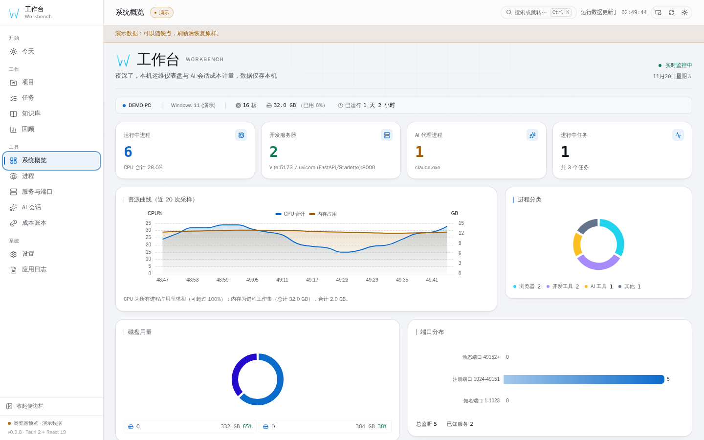
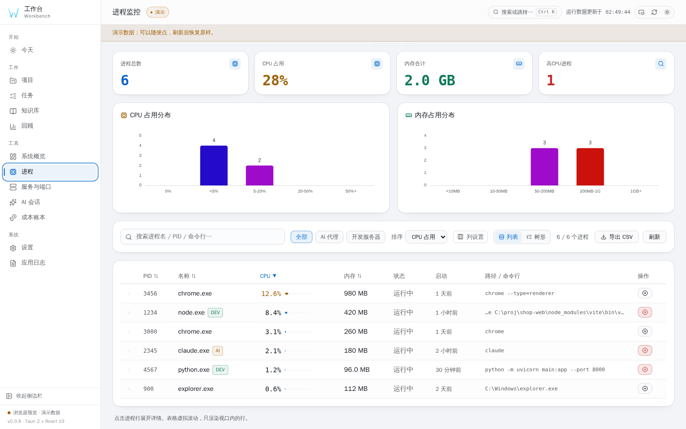
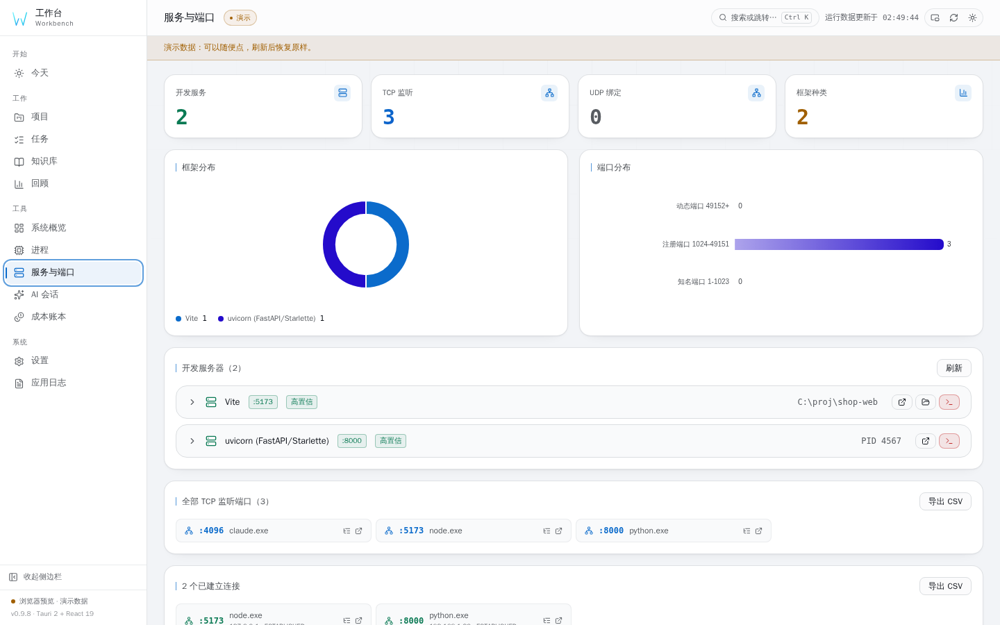
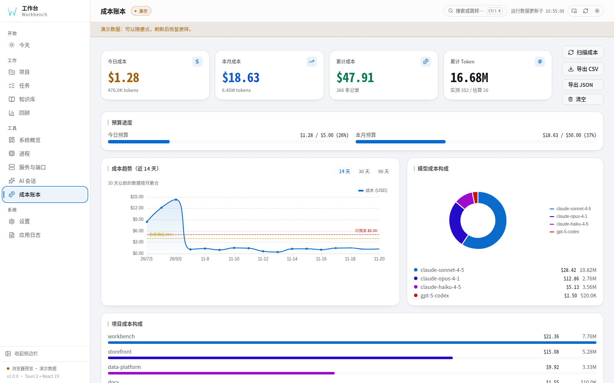
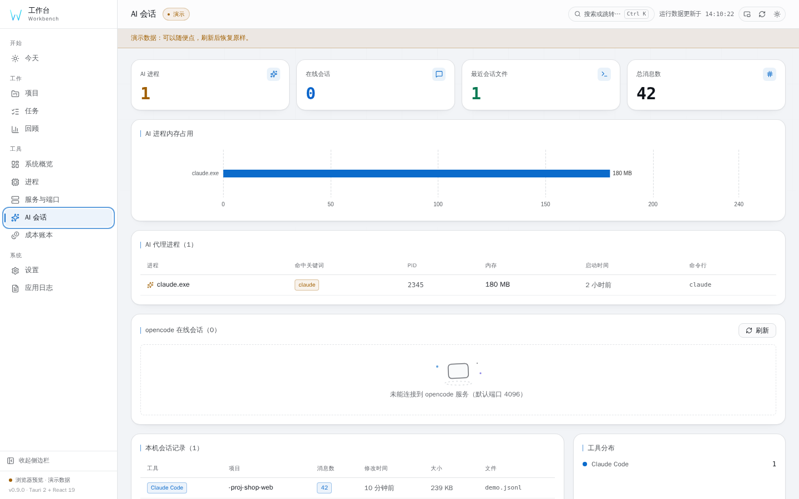

# 工作台 Workbench

[English](README.md) | **简体中文** | [日本語](README.ja.md)

[](CHANGELOG.md)
[](LICENSE)
[](docs/ARCHITECTURE.zh-CN.md#系统要求)
[](#质量)



**给每天真正在用的这台机器，一个本地优先的工作台。**

今天要做什么、项目和任务推进到哪、端口被谁占着、AI 会话花了多少，都在一个窗口里。
不需要账号，不接云端，没有遥测。

## 为什么用它

- **从今天开始。** 首页只回答“现在该处理什么”：逾期、今天到期、进行中、阻塞和收件箱。
  项目有目标、进度和下一步，任务有状态和阻塞原因，一天不再是一堆文件夹。
- **顺着端口找到进程。** 监听端口直接连到占用它的进程，进程详情反过来列出它持有的全部端口。
  开发服务会按框架标出来，不用猜是哪个终端启动的。
- **看清 AI 的真实花费。** 本地 Claude Code / Codex 会话文件会整理成 SQLite 账本，
  带模型拆分、预算和 14 天趋势。原始文件留在原地。
- **把本地知识放在手边。** 直接挂载 Markdown 文件夹，搜索标题、正文、标签和项目关联。
  同一份上下文也能通过 MCP 交给支持它的客户端，写入默认关闭。
- **数据留在自己手里。** 所有内容都在这台机器上。唯一的外部请求，是对本地 opencode
  服务的可选探测。

## 运行

从 [Releases](../../releases) 下载安装包，或从源码运行：

```bash
npm ci
npm run tauri dev      # 桌面开发模式，支持热更新
npm run tauri build    # 安装包输出到 src-tauri/target/release/bundle/
```

同一个二进制也可以不打开窗口：

| 形态 | 命令 | 得到什么 |
| --- | --- | --- |
| 桌面 | 安装发行包 | 完整应用：托盘、全局快捷键、迷你窗口、进程操作 |
| Web | `workbench serve` | 本地 UI 和 API 跑在 `127.0.0.1:7788`，机器状态只读 |
| 命令行 | `workbench ps`、`ports`、`diag`、`cost`、`mcp` | 可脚本化，支持 JSON 输出，无窗口 |

```bash
workbench ps              # PID、名称、CPU、内存、父进程、状态
workbench ports           # 监听端口与占用它的 PID
workbench cost --days 7   # AI 会话花费
workbench serve           # Web UI 与 HTTP API
```

## 界面一览

| 进程 | 服务与端口 |
| --- | --- |
|  |  |
| 实时进程、端口与开发服务标记 | 监听端口、已建立连接与框架识别 |

| 成本账本 | AI 会话 |
| --- | --- |
|  |  |
| 预算、模型拆分与 14 天趋势 | 本地 Claude Code / Codex 会话与已识别的代理进程 |

## 质量

每次发布都会经过 TypeScript、ESLint、Prettier、Vitest、Rust 测试、Clippy、
Playwright 视觉测试、`npm audit` 和 `cargo audit`。本地可以用
`node scripts/ci-local.mjs` 跑同一套步骤，CI 配置见
[GitHub Actions](.github/workflows/ci.yml)。

## 文档

- [架构与参考](docs/ARCHITECTURE.zh-CN.md) ·
  [English](docs/ARCHITECTURE.md) · [日本語](docs/ARCHITECTURE.ja.md)
- [同类工具对比](docs/COMPARISON.zh-CN.md) ·
  [English](docs/COMPARISON.md) · [日本語](docs/COMPARISON.ja.md)
- [路线图](docs/ROADMAP.md) · [工程边界](docs/ENGINEERING.md)
- [参与贡献](CONTRIBUTING.md) · [安全策略](SECURITY.md) ·
  [行为准则](CODE_OF_CONDUCT.md) · [更新日志](CHANGELOG.md)

## 许可

[MIT](LICENSE) © 2026 x1882
