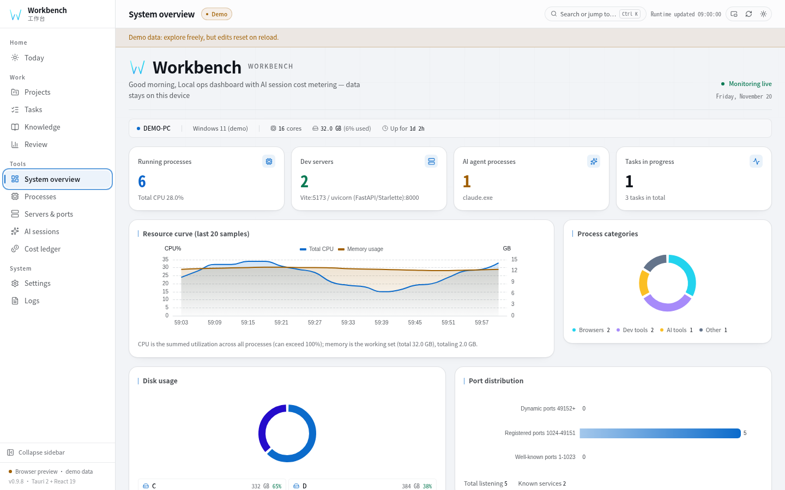
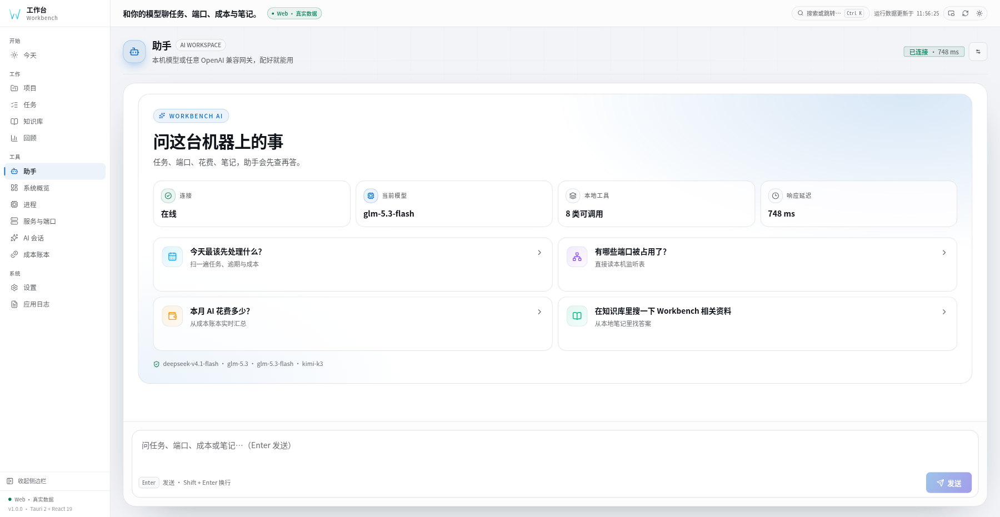
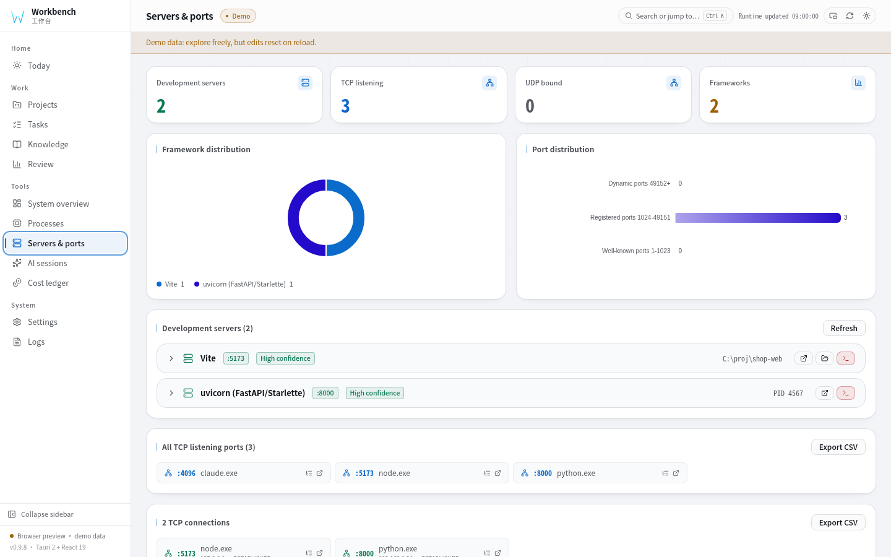
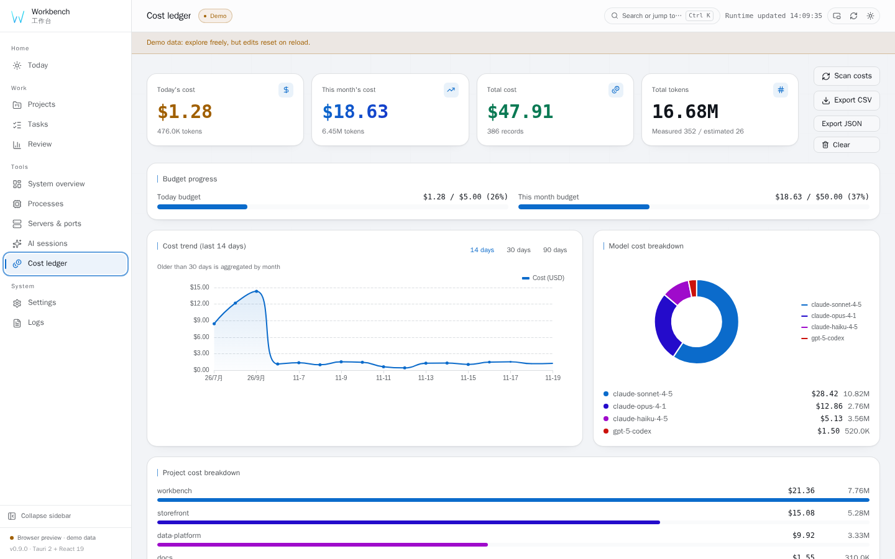

# Workbench

[English](README.md) | **简体中文**

[](CHANGELOG.md)
[](LICENSE)
[](docs/ARCHITECTURE.zh-CN.md#系统要求)
[](https://github.com/X33834/workbench/actions/workflows/ci.yml)



给每天真正在用的这台机器，一个本地优先的工作台。任务、项目、端口、进程、AI 花费和笔记放在一个窗口里。不需要 Workbench 账号，也不上传遥测；只有你主动配置的模型端点可能离开本机。

## 它能做什么

- **看今天该做什么。** 逾期任务、今天到期、进行中的项目、阻塞项和收件箱，一屏看完。
- **顺着端口找到进程。** 监听端口直接连到占用它的进程，进程详情反过来列出它持有的全部端口；开发服务按框架标记。
- **看清 AI 的真实花费。** 本地 Claude Code / Codex 会话文件整理成 SQLite 账本，带预算和模型拆分。
- **把笔记放在手边。** 直接挂载 Markdown 文件夹，搜索标题、正文、标签和关联项目；同一份上下文也能通过 MCP 交给支持它的客户端。
- **问自己的模型。** 可选助手会先查任务、端口、花费和笔记再回答；只有打开写入开关后才会创建任务。

## 运行

从 [GitHub Releases](https://github.com/X33834/workbench/releases) 下载安装包，国内也可以用 [Gitee](https://gitee.com/badhope/workbench/releases) 或 [GitCode](https://gitcode.com/badhope/workbench/releases)。Windows 提供 NSIS，Linux 提供 `.deb` 和 AppImage，macOS 提供 DMG。

```bash
npm ci
npm run tauri dev      # 桌面开发模式，支持热更新
npm run tauri build    # 安装包输出到 src-tauri/target/release/bundle/
```

同一个二进制也可以不打开窗口：

```bash
workbench ps              # 进程
workbench ports           # 监听端口与占用 PID
workbench cost --days 7   # AI 会话花费
workbench serve           # 本地 Web UI 和 HTTP API
workbench mcp             # stdio MCP 服务
```

## 助手

助手是可选功能。在设置里填本地 OpenAI 兼容服务，或远程 HTTPS 网关即可。它会先用本地工具查任务、端口、成本、日期、算术和知识库，再把真实结果交给模型总结。

## 界面

[▶ 观看界面巡览](docs/screenshots/workbench-tour.mp4)

| 今天 | 助手 |
| --- | --- |
|  |  |
| 现在该处理什么 | 问任务、端口、花费和笔记 |

| 服务与端口 | 成本账本 |
| --- | --- |
|  |  |
| 监听端口与占用进程 | 按模型和预算看 AI 花费 |

## 质量

每次发布都会跑 TypeScript、ESLint、Prettier、Vitest、Rust 测试、Clippy、
Playwright 视觉检查、`npm audit` 和 `cargo audit`。本地可以用
`node scripts/ci-local.mjs` 跑同一套步骤，CI 配置见
[GitHub Actions](.github/workflows/ci.yml)。

## 文档

- [文档索引](docs/README.md)
- [架构与参考](docs/ARCHITECTURE.zh-CN.md) · [English](docs/ARCHITECTURE.md)
- [同类工具对比](docs/COMPARISON.zh-CN.md) · [English](docs/COMPARISON.md)
- [工程边界](docs/ENGINEERING.md) · [路线图](docs/ROADMAP.md)
- [参与贡献](CONTRIBUTING.md) · [安全策略](SECURITY.md) · [更新日志](CHANGELOG.md)

## 许可

[MIT](LICENSE) © 2026 x1882
</content>
