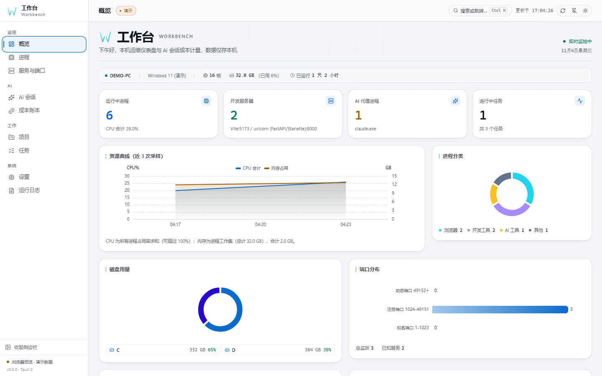
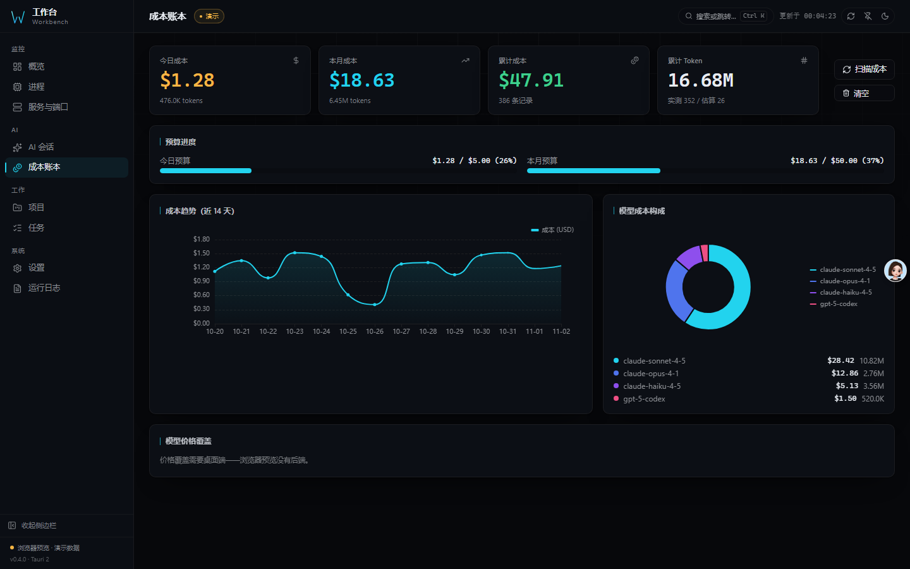
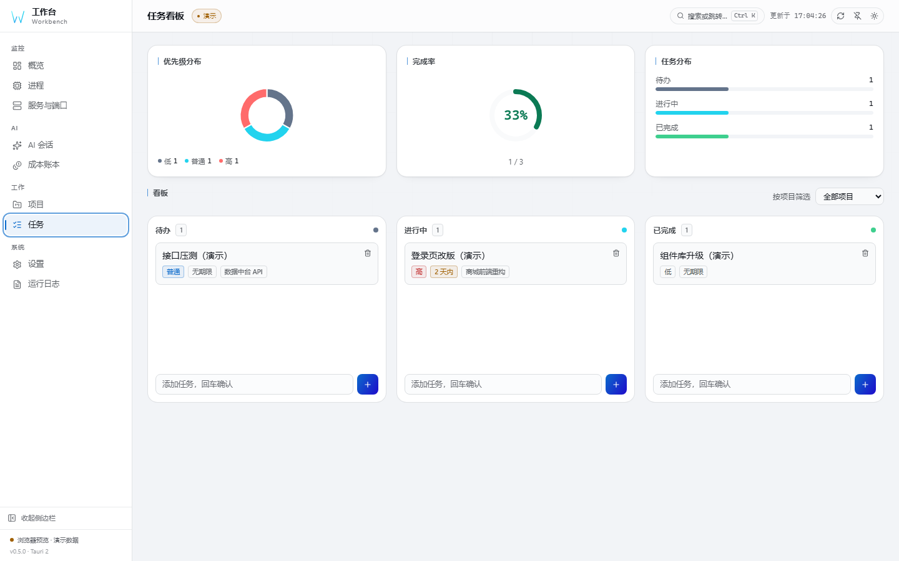

# 工作台 Workbench

[English](README.md) | **简体中文** | [日本語](README.ja.md)

[](CHANGELOG.md)
[](LICENSE)
[](docs/ARCHITECTURE.zh-CN.md#系统要求)
[](#质量门禁)


**看见端口，找到进程，算清成本，推进工作。**

面向在本机跑服务、跑 AI 编码代理的开发者。一个窗口回答四件事：
今天该做什么、每个项目和任务推进到哪、每个端口被谁占着、Claude Code / Codex
会话到底花了多少钱。数据不出本机——没有账号、没有云端、不需要配置模型。

## 与同类工具的不同

| | |
|---|---|
| **先看今天** | 首页回答"现在做什么"：逾期、今天到期、进行中、阻塞、收件箱一目了然，而不是一堆 CPU 仪表。 |
| **端口 → 进程 → 成本** | 监听端口一键跳到占用它的进程，进程详情反过来列出它持有的全部端口。会话文件把同一台机器上的工作和真实花费连起来。同类本地工具没有把这三层接在一起。 |
| **项目，不是文件夹** | 项目有目标、进度和下一步；任务有状态、优先级、截止日、下一步和阻塞原因。本地路径只是可选元信息，不是项目身份。 |
| **键盘优先** | Ctrl/Cmd+K 搜索页面、进程、端口、项目、任务，然后直接落进结果——按项目筛选，或聚焦任务详情。 |
| **诚实的本地优先** | 账本是本机 SQLite，CSP 收紧到 self，无遥测。唯一的外部请求是可选探测本机 opencode 服务。 |

## 三种运行方式

| 形态 | 启动方式 | 你能得到什么 |
|------|----------|--------------|
| **桌面** | 装安装包，或 `npm run tauri dev` | 完整能力：托盘、全局快捷键、工作小窗、提权结束进程、系统通知 |
| **Web** | `workbench serve` | 同一套后端以 HTTP 跑在 `127.0.0.1:7788`，把构建好的界面临给浏览器。数据是真实的。机器状态只读：结束进程和清日志仅限桌面端 |
| **演示** | 打开已部署的落地页 | 静态样例数据，不安装也能评估界面；有横幅明确提示 |

顶栏徽章始终标明当前处在哪一种——`实时` / `Web · 真实数据` / `演示`——屏幕上的数字不会含糊其辞。

## 界面预览

| 工作台首页 | 回顾 |
|------|------|
|  |  |
| 当前项目、今天列表、快速记录、注意力计数 | 完成趋势、项目进度、状态与优先级分布 |

| 进程监控 | 服务与端口 |
|------|----------|
|  |  |
| 列表 / 父子树、虚拟滚动、CSV 导出 | netstat / ss 解析、开发框架标注 |

| 成本账本 | 任务 |
|------|------|
|  |  |
| 预算进度、趋势、模型分解 | 列表 + 看板、状态与阻塞标记 |

| 命令面板 | 工作小窗 |
|--------|----------|
|  |  |
| Ctrl/Cmd+K 横跨页面 / 进程 / 端口 / 项目 / 任务 | 当前工作 + 今天 + 快速记录，可置顶 |

## 功能

| 功能 | 说明 |
|------|------|
| **工作台首页** | 逾期 / 今天 / 进行中 / 阻塞 / 收件箱计数；当前项目带目标、进度环和下一步；快速记录进收件箱 |
| **项目与任务** | 项目带目标、状态和进度；任务带状态、优先级、截止日、下一步、阻塞原因和完成时间；列表 + 看板双视图；键盘与鼠标双路径 |
| **实时监控** | 进程、监听端口（Windows 用 `netstat`，Linux 用 `ss -tulpn` 并回退 netstat）、开发服务器识别（框架 + 置信度） |
| **进程树** | 列表 / 父子树双视图，基于 `parent_pid` 构建且对孤儿与环安全；虚拟滚动、行内详情、CSV 导出 |
| **命令面板** | Ctrl/Cmd+K 模糊搜索；选中项目直接按项目筛选进入任务页，选中任务直接打开详情 |
| **AI 成本计量** | 本机 Claude / Codex 会话 token 成本，SQLite 本地账本——不依赖任何模型、不要 API key、数据不出本机 |
| **回顾** | 完成趋势（14 天）、项目进度、状态与优先级分布——全部从真实数据计算，并如实说明哪些缺少历史 |
| **价格编辑器** | 40+ 模型价格内置，界面内改价 / 新增 / 恢复内置价 |
| **备份恢复** | 带时间戳快照，一键回滚，恢复前完整性校验 |
| **工作小窗** | 始终置顶的轻量伴侣：当前项目、今天任务、快速记录；通过 BroadcastChannel 与主窗同步 |
| **开机自启** | 真实系统级注册，开关状态回读操作系统 |
| **环境自检** | 平台、数据目录、成本库、会话目录、端口工具逐项 ok / warn / fail，报告可一键复制 |
| **命令行模式** | 一个可执行文件：`ps` / `ports` / `diag` / `cost` / `serve`（都支持 `--json`），可进脚本、不弹窗口 |
| **视觉系统** | 7 种概览版面 × 16 套主题 × 3 种外壳，组件可拖拽 / 隐藏并单独设宽度，主题编辑器与分享链接 |
| **三语界面** | 简体中文（默认）/ English / 日本語 |
| **跨平台** | CI 定义了 Windows、Linux 和 macOS 的任务，包括 Linux `.deb` 与 macOS `.app` 构建 |

## 质量门禁

每条声明都有一条命令验证。本地与 CI 跑同一套步骤：

| 门禁 | 拦截什么 |
|------|----------|
| `npm run version:check` | 四处版本号互相漂移 |
| `npx tsc --noEmit` | 类型错误，含生成的 IPC 契约 |
| `npm run lint` · `npm run format:check` | ESLint 零告警、Prettier 格式 |
| `npm test` | **575** 个前端测试，带覆盖率阈值 |
| `cargo test --lib` | **178** 个后端测试，含 ts-rs 绑定导出 |
| `npm run test:e2e` | **25** 个 Playwright 用例：导航、WCAG AA 对比度、视觉基线 |
| `cargo clippy -- -D warnings` | Rust lint，零容忍 |
| `npm audit` · `cargo audit` | 两套依赖树中的已知漏洞 |

## 构建

需要 Node.js `^22.22.2 || ^24.15.0 || >=26.0.0` 和 Rust ≥ 1.90：

```bash
npm install
npm run tauri dev      # 桌面开发模式（热重载）
npm run tauri build    # 安装包 → src-tauri/target/release/bundle/
```

命令行（同一可执行文件，无窗口）：

```bash
workbench ps              # 全部进程：pid、名称、cpu%、内存、父进程、状态
workbench ports           # 监听 TCP/UDP 端口及所属 PID
workbench diag            # 环境自检
workbench cost            # AI 会话成本摘要（--days N、--by-project）
workbench serve           # 无头 HTTP API + Web UI，127.0.0.1:7788
workbench ports --json    # 脚本可读输出
```

技术栈、项目结构、FAQ 等详见
[架构与参考文档](docs/ARCHITECTURE.zh-CN.md)。

## 贡献与许可

- 贡献流程：[CONTRIBUTING.md](CONTRIBUTING.md) · 安全：[SECURITY.md](SECURITY.md) ·
  行为准则：[CODE_OF_CONDUCT.md](CODE_OF_CONDUCT.md) · 变更日志：[CHANGELOG.md](CHANGELOG.md)
- [MIT](LICENSE) © 2026 x1882
