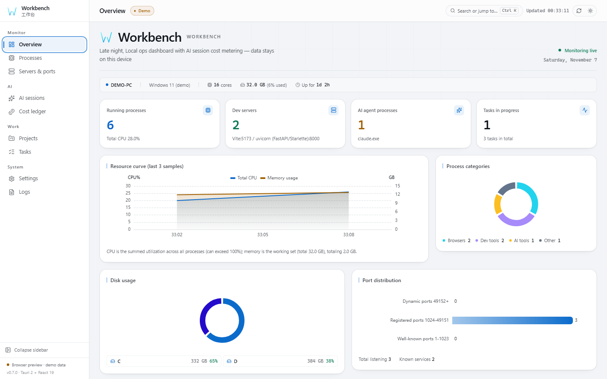
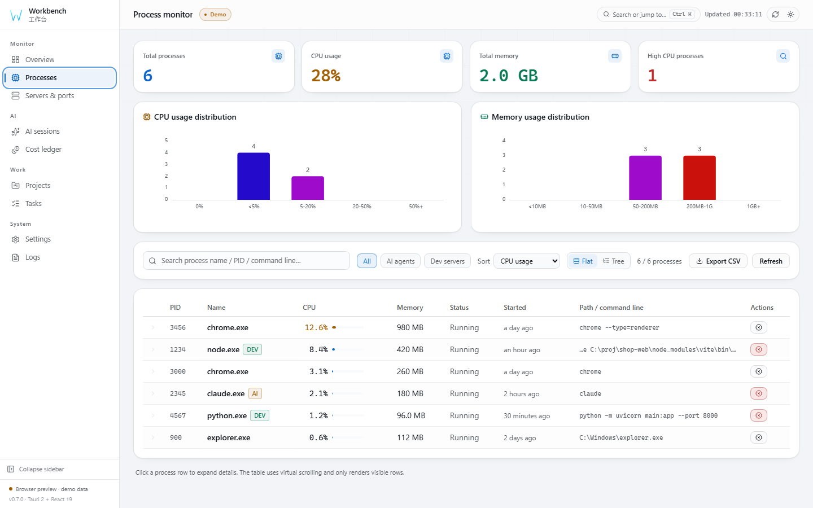
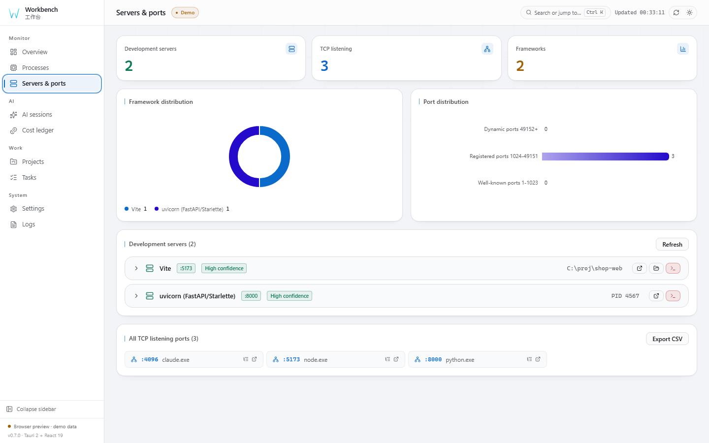
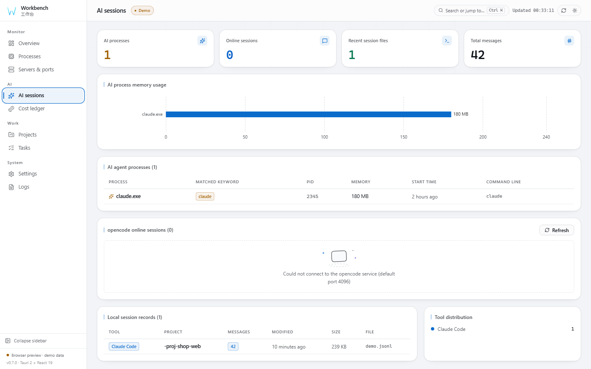
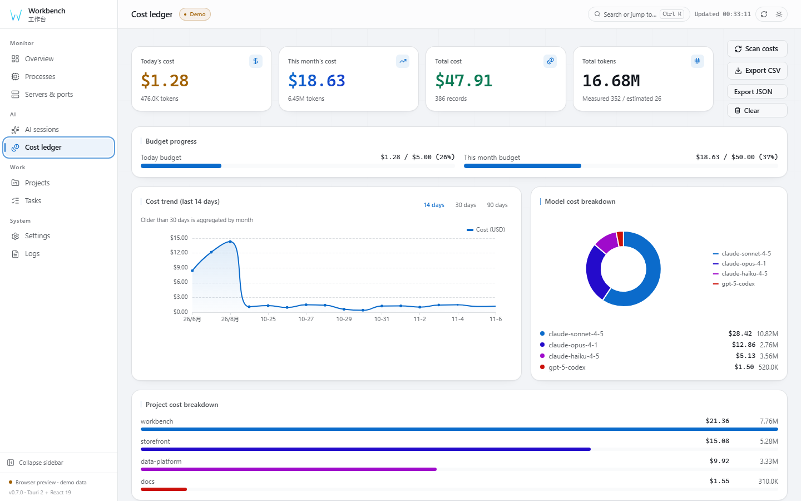
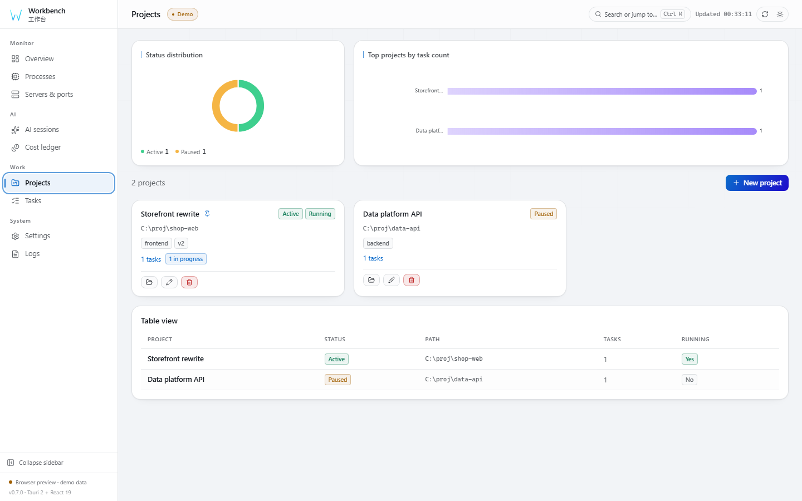
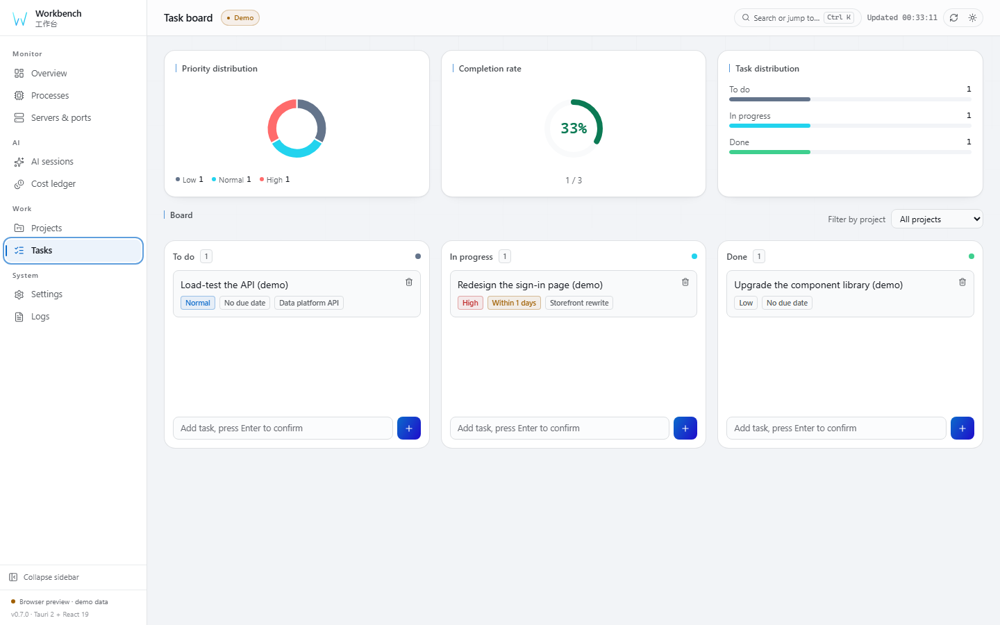
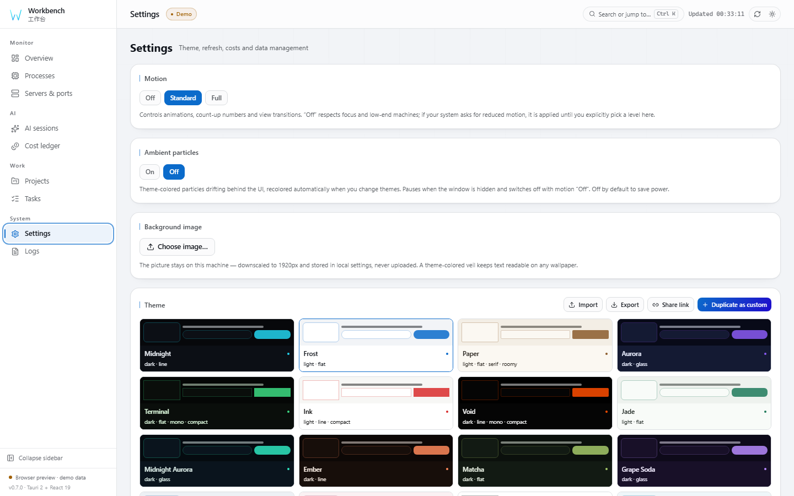
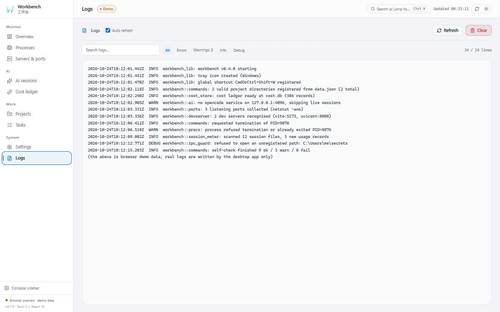

# アーキテクチャ & リファレンス

> Workbench の詳細リファレンス。README はショーケース、技術的な詳細はこちら。
> 他の言語: [English](ARCHITECTURE.md) / [简体中文](ARCHITECTURE.zh-CN.md)。

## 機能

| モジュール | 機能 |
|------------|------|
| 🖥 **概要** | CPU / メモリの推移グラフ、ディスク使用率ドーナツ、プロセス分類統計 |
| ⚙ **プロセス** | 全プロセス snapshot、CPU / メモリソート、仮想スクロール（視覚領域のみ描画）、強制終了の二重確認、AI エージェント検出 |
| 🌐 **サーバー & ポート** | netstat によるリッスン検出、開発フレームワーク判定（Vite / Next / Django…） |
| 🤖 **AI セッション** | opencode オンラインセッション、ローカル Claude / Codex セッションプレビュー |
| 💰 **コスト計測** | トークン消費、日別推移、予算アラート、Anthropic キャッシュの課金 |
| 📁 **プロジェクト** | ローカルプロジェクト管理、Git ブランチ自動検出 |
| ✅ **タスク** | カンバンボード（ドラッグで状態変更） |
| ⚙ **設定** | テーマエディタ、シェル / レイアウト / ウィジェット配置、更新間隔、予算しきい値、JSON 入出力、バックアップ & 復元、ログイン時に起動 |
| 📋 **ログ** | 内蔵ビューア、自動更新、末尾読み取り |

## コスト計測

- **3 段階の信頼度**: measured（API 報告の usage）→ estimated（文字数ヒューリスティック）→ zero_pricing
- **40+ モデルの価格を内蔵**。コスト台帳ページに価格上書きエディタを搭載し、
  単価の変更・モデルの追加・内蔵価格への復元ができます（`pricing_overrides.json`
  に保存され、不正な価格はテーブル全体として拒否されます）
- **Anthropic キャッシュの意味論**: `input_tokens` にキャッシュは含まれず、
  `cache_read_input_tokens` は 0.1 倍、`cache_creation_input_tokens` は 1.25 倍で
  別途計上
- **日付帰属**: measured / estimated とも JSONL 行単位の `timestamp` で日別集計
  （欠損時は前日 / ファイル mtime にフォールバック）。セッション追記は最新日だけを
  更新し、過去の推移は書き換わりません
- **未知モデルは無課金**: 特定できないモデルは `unknown` として `zero_pricing` 扱い、
  でっち上げの単価は付けません
- **冪等**: セッションファイルごとに最新スナップショットのみ保持（`file_path`
  単位で丸ごと置換）。再スキャンで古い行が積み重なることはありません
- **推定はオフ可**: 設定の「推定レコードを含める」トグルで概要 / 推移 / モデル別が
  即時更新されます
- **予算アラート**: システム通知。重複通知は抑止
- **スキャン範囲**: `~/.claude/projects` と `~/.codex/sessions` 配下の全セッション
  ファイル（UI プレビューは最新 10 件のみ表示）

## デスクトップ動作

- ウィンドウを閉じるとトレイに格納。トレイ左クリックで表示切替、トレイメニューの
  終了で実際にプロセスを終了
- グローバルホットキー `Ctrl+Shift+W` で表示 / 非表示（競合時は警告に劣化し、
  起動は妨げません）
- ログは起動単位でローテーション（5 MB 超で `workbench.log.1` に退避）。
  ログページは末尾から必要分だけ読み取ります
- PID 0/4 と重要システムプロセス（csrss / lsass / services 等）の強制終了は拒否

## はじめに

### システム要件

| 項目 | 要件 |
|------|------|
| OS | Windows / Linux / macOS の CI ジョブを定義。プラットフォームごとの検証状況は異なります |
| ランタイム | Windows は WebView2（Windows 11 に同梱）、Linux は WebKitGTK 4.1、macOS はシステムの WebView を使用 |
| ディスク | プラットフォームとバンドルによって異なります |
| 権限 | 管理者権限は不要。プロセス終了には対象と同等以上の権限が必要。通常終了が失敗した場合は、UAC による昇格でワンクリック再試行できます（Windows のみ） |
| ネットワーク | 不要。AI セッションページを開いたときにローカル opencode サービスを探知するだけ |

### Release からインストール

[最新リリース](https://github.com/X33834/workbench/releases/latest) で利用可能なアセットを確認してください。
アセットの提供状況と署名状態はここでは検証していません。

### ソースからビルド

必要環境: 固定されたフロントエンド依存関係には [Node.js](https://nodejs.org/) `^22.22.2 || ^24.15.0 || >=26.0.0`、
また [Rust](https://www.rust-lang.org/tools/install) ≥ 1.90 と各プラットフォームの WebView ランタイムが必要です。

```bash
npm install
```

### IPC 契約型の生成

IPC をまたぐ型は `src/types.ts` に手書きせず、Rust 構造体から生成します:

```bash
cd src-tauri
cargo test --test export_bindings   # src/generated/*.ts を再生成
```

`src/types.ts` は re-export のみ、`src/generated/` がコミット済みの契約
スナップショットです。Rust 構造体を変更したら必ず上記を再実行してください。
さもないと CI のドリフトゲートに弾かれます。

### 開発

```bash
npm run tauri dev      # デスクトップ開発モード（ホットリロード付き）
npm run dev            # フロントエンドのみ。ブラウザデモモード。Rust 不要
```

### 本番ビルド

```bash
npm run tauri build
```

成果物は `src-tauri/target/release/bundle/` に出力されます。

## 技術スタック

| レイヤー | 採用技術 |
|----------|----------|
| ランタイム | Tauri 2（Rust + OS WebView） |
| フロントエンド | React 19 + TypeScript（strict）+ Vite 8 |
| 状態管理 | Zustand 5（persist） |
| スタイル | Tailwind CSS 4 + 二テーマ CSS 変数 |
| グラフ | ECharts 6（必要分のみ取り込み、ダーク/ライト両テーマ登録） |
| 仮想スクロール | @tanstack/react-virtual 3（展開行の可変高さ対応） |
| 購読 | Zustand 5 `useShallow` セレクタ + `memo` ページコンポーネント |
| IPC | Tauri IPC + spawn_blocking |
| 契約 | ts-rs 12 が Rust 構造体から `src/generated/*.ts` を生成、CI がドリフト検証 |
| プロセス取得 | sysinfo |
| ポート解析 | netstat パーサー（POSIX / Windows 両方言） |
| 多言語 | 簡体中文デフォルト、英語 / 日本語に切替可 |
| 品質ゲート | ESLint 10 + Prettier 3 + vitest 5 + clippy `-D warnings` |

## プロジェクト構成

```
workbench/
├── src/                    # フロントエンド
│   ├── pages/              # 8 つの機能ページ（遅延読み込み）
│   ├── lib/                # store / api / echarts / chartTheme / i18n / util
│   ├── generated/          # ts-rs 生成の IPC 契約型（手動編集禁止）
│   ├── ui.tsx              # 共有コンポーネント
│   ├── types.ts            # 型の re-export とフロント固有の型
│   ├── App.tsx             # アプリシェル
│   └── styles/global.css   # グローバルスタイルとテーマ変数
├── src-tauri/              # Rust バックエンド
│   ├── capabilities/       # Tauri 権限セット（最小構成）
│   ├── icons/              # アプリアイコン（scripts/make_icons.py が生成）
│   ├── src/
│   │   ├── commands.rs     # IPC コマンド層
│   │   ├── procs.rs        # プロセス snapshot と終了
│   │   ├── ports.rs        # netstat 解析
│   │   ├── devserver.rs    # 開発フレームワーク判定
│   │   ├── ai.rs           # AI セッション取得
│   │   ├── pricing.rs      # モデル価格マッチング
│   │   ├── session_meter.rs# JSONL トークンコスト解析
│   │   ├── cost_store.rs   # コストデータ永続化
│   │   ├── ipc_guard.rs    # IPC 引数ホワイトリスト
│   │   └── lib.rs          # Tauri 起動エントリ
│   └── tests/              # IPC 契約エクスポートテスト
├── docs/                   # GitHub Pages ランディングページ + スクリーンショット
├── scripts/                # アイコン生成・スクリーンショット補助
└── .github/workflows/      # CI / Release / Pages
```

## 開発と品質

```bash
npm run format:check       # Prettier
npm run lint               # ESLint（警告ゼロ）
npm run test               # フロントエンド単体テスト（vitest）
npm run coverage           # カバレッジ（v8）
npm run dup                # 重複コード（jscpd、しきい値 3%）
npm run build              # tsc + vite build
node scripts/ci-local.mjs  # CI と同じ全ステップをローカルで実行

cd src-tauri
cargo test                 # バックエンドテスト + IPC 契約エクスポート
cargo clippy --all-targets -- -D warnings   # 警告ゼロゲート
```

パッケージ版の E2E（実際の Tauri ウィンドウ + 実 IPC）。exe を
`WEBVIEW2_ADDITIONAL_BROWSER_ARGUMENTS=--remote-debugging-port=22300` で起動してから:

```bash
node scripts/e2e-desktop.mjs 22300   # データ / バックアップ復元 / 価格 / ログイン時起動
node scripts/e2e-io.mjs 22300        # インポート / エクスポート
```

純粋な Rust ロジック（netstat 解析、フレームワーク判定、価格マッチング、トークン
抽出、JSON 永続化、IPC ガード）には `#[cfg(test)]` の単体テストがあり、フロント
エンドは vitest（util / store / 共有コンポーネント / エラー境界）でカバーしてい
ます。CI はフォーマット・Lint・型チェック・ビルド・両側のテスト・clippy 警告ゼロ
に加え、`src/generated/` と Rust 構造体の一致も検証します。

## FAQ

<details>
<summary>コスト計測はどう計算されますか？正確ですか？</summary>

ローカルの Claude Code / Codex セッション JSONL 内の `usage` フィールドを解析し、
内蔵の 40+ モデル価格で計算します。信頼度は 3 段階:

- **measured** —— API が報告した実際の usage。最も正確
- **estimated** —— usage なし。文字数ヒューリスティックで推定（設定でオフ可）
- **zero_pricing** —— モデルを特定できず、無課金として記録（単価の捏造はしない）

Anthropic のキャッシュトークンは公式の意味論に従います（読み 0.1 倍、
書き 1.25 倍）。
</details>

<details>
<summary>データをクラウドに送信しますか？</summary>

いいえ。プロジェクト・タスク・コスト台帳・ログはすべてローカルの app data
ディレクトリに書き込まれます。アプリがローカルで行うのは 2 つだけ: `netstat`
でポートを確認、ローカルのセッションファイルでコストを計算。唯一の任意の通信は
ローカル opencode サービス（既定ポート 4096）の探知で、失敗しても「未検出」と
表示されるだけで他機能への影響はありません。
</details>

<details>
<summary>プロセスを殺してもシステムを壊しませんか？</summary>

いいえ。PID 0/4 と重要システムプロセス（csrss、lsass、services 等）はバックエンド
が拒否します。フロントエンドは事前に確認を求め、終了前に対象の同一性を再検証して
PID 再利用による誤爆を防ぎます。
</details>

<details>
<summary>閉じたウィンドウはどこへ？終了方法は？</summary>

トレイへの格納は意図的な設計です（常駐監視のため）。トレイアイコンを右クリックし
「終了」を選ぶと実際に終了します。<code>Ctrl+Shift+W</code> でいつでも表示 /
非表示を切り替えられます。
</details>

<details>
<summary>Windows が「不明な発行元」と警告します</summary>

実行するかどうかを決める前に、ダウンロードしたファイルの発行元と署名状態を確認してください。
リリースアセットの提供状況と署名状態はここでは検証していません。
</details>

## ロードマップ

- [x] プロセス / ポート / 開発サーバーのリアルタイム監視
- [x] AI セッションのコスト計測と予算アラート
- [x] プロジェクト & タスクカンバン
- [x] ダーク / ライトテーマ、ログビューア
- [x] 多言語 UI（English / 简体中文 / 日本語）
- [x] Windows / Linux / macOS 向けのクロスプラットフォーム CI ジョブを定義
- [ ] インストーラーのコード署名（有料証明書が必要）
- [x] `pricing_overrides.json` の UI エディタ
- [x] SQLite コスト台帳（10 万件の集計が 246ms、シャーディング不要）
- [x] ページ単位の E2E（Playwright 10 ページ × 8 テーマ + パッケージ版 2 種）
- [x] ウィジェット幅の変更（4/6/8/12 カラム）
- [x] テーマ共有リンク（テーマを URL に圧縮、開くだけで読み込み、バックエンド不要）
- [x] 管理者として終了（通常終了失敗後に UAC を提示。保護対象プロセスはバックエンドが事前拒否）
- [x] プロセスツリー表示（`parent_pid` で構築、孤児・循環に安全、仮想スクロール）
- [x] コマンドパレット（Ctrl/Cmd+K でページ・プロセス・ポート・プロジェクト・タスク）
- [x] ポート → プロセスの移動、プロセス詳細での逆引きポート一覧
- [x] プロセスと待受ポートの CSV 書き出し
- [x] 環境チェック（項目ごとに ok / warn / fail、レポートはコピー可能）
- [ ] 自動更新（署名済みリリース経路が必要）

## 既知の制限

- ポート取得は Windows が `netstat -ano`、Linux が `ss -tulpn`（`netstat` にフォールバック）。
  CI に Linux バックエンドのチェックと `.deb` ビルドを定義していますが、プラットフォームとリリースアセットは別途検証が必要です
- 操作パスは Playwright（10 ページ × 8 テーマの構造 / コントラスト回帰）、
  コマンドパレット / プロセスツリー / ポート移動 / CSV 書き出しの構造テスト、
  パッケージ版のデスクトップ E2E（実 IPC）でカバー
- コスト台帳は SQLite（`cost.db`、rusqlite bundled）で、日付 / モデル / ファイルに
  索引を持ちます。集計は SQL 内で完了するため、10 万件でも約 250ms。
  旧 `cost_data.json` は初回起動時に取り込み、`.migrated` に改名します（削除しません）
- リリースインストーラーの署名状態と提供状況はここでは検証していません
- トレイメニューは中英併記で、UI の言語切替には追随しません（起動時に一度だけ構築）
- **プラグイン API とリモート/複数マシン監視はありません**——意図的な割り切りです。
  ただしローカル専用の HTTP API は存在します: `workbench serve` が同一マシンの
  ブラウザ向けに同じ読み取り経路を公開します（ループバック限定で、リモート監視では
  ありません）。
  代償は [COMPARISON.ja.md](COMPARISON.ja.md) に書いています

## データの保存先

| ファイル | 用途 | 場所 |
|----------|------|------|
| `data.json` | プロジェクトとタスク | app data dir |
| `cost.db` | コスト記録 + 価格設定（SQLite） | app data dir |
| `pricing_overrides.json` | ユーザー定義のモデル価格（コスト台帳で編集可能） | app data dir |
| `workbench.log` | 実行ログ | app data dir |
| `*.corrupt-<timestamp>` | 解析失敗時の元データバックアップ（次回保存で上書きされない） | app data dir |

Windows の app data dir は `%APPDATA%\com.workbench.desktop` です。

## スクリーンショット一覧

以下の画像は**ブラウザデモモード**（`npm run preview`）で撮影したものです:
Tauri 環境以外では `src/lib/demo.ts` のデモデータを注入するため、パスや
ホスト名はすべてプレースホルダーで、実機データは含まれません。

| 概要 | プロセス |
|------|----------|
|  |  |
| CPU / メモリ傾向、ディスク、プロセス分類 | 全プロセス snapshot、仮想スクロール、強制終了の確認 |

| サーバー & ポート | AI セッション |
|-------------------|----------------|
|  |  |
| netstat 解析、開発フレームワーク判定 | セッションファイル、オンラインセッション、ツール分布 |

| コスト台帳 | プロジェクト |
|------------|--------------|
|  |  |
| 予算進捗、推移、モデル内訳、価格エディタ | ローカルプロジェクト、Git ブランチ検出 |

| タスク | 設定 |
|--------|------|
|  |  |
| ドラッグ＆ドロップのカンバン | テーマ、更新間隔、予算、インポート/エクスポート |

| ログ | 5 つのスタイル |
|------|----------------|
|  |  |
| 内蔵ログビューア、末尾読み取り | 1 つのトークン群を共有し、色相だけでなく表面色・角丸・密度・書体で差別化 |

### ビジュアルシステム

| ブランドマーク（サイドバー） | ブランドマーク（マストヘッド） |
|------------------------------|--------------------------------|
|  |  |

マークは 4 本のベクターストローク（`currentColor`、底板なし）で、どの背景でも
そのまま重なります。

| 各サイズのアイコン | exe に埋め込まれたアイコン |
|--------------------|----------------------------|
|  |  |

| 折りたたみサイドバー | 狭い画面（ドロワー） |
|----------------------|----------------------|
|  |  |

### テーマ、シェル、レイアウト

テーマは**データであって CSS ではない**: 6 色と 6 つの形状ノブが 26 個の CSS 変数と
対応するチャートパレットに展開されます。以下はすべて「設定 → 外観」から到達でき、
内蔵テーマは複製して自由に編集できます。

| Orbit レイアウト（Aurora） | Ledger レイアウト（Ink） |
|-----------------------|---------------------|
|  |  |

| Zen レイアウト（Void） | Dense レイアウト（Terminal） |
|-------------------|--------------------------|
|  |  |

| Dock シェル | Zen シェル |
|------------|-----------|
|  |  |

- **シェル**はナビゲーション位置を決めます: 左サイドバー / 上部ドック / アイコン列。
- **レイアウト**は概要ページを再構成します: bento / ledger / orbit / dense / zen。
- **ウィジェット**は両者と独立してドラッグ・並べ替え・非表示ができます。

スクリーンショットは自分で再生成できます: `npm run build` → `npm run preview`
→ ヘッドレス Chrome を `--remote-debugging-port=9222` で起動 →
`node scripts/shoot_docs.mjs`。スクリプトはデモモードであることを検証し、
失敗時は撮影を拒否するため、実データがリポジトリに入ることはありません。
