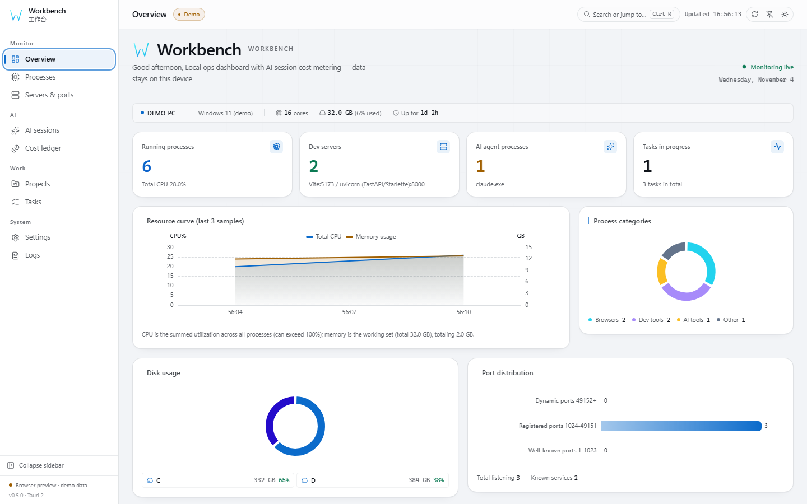
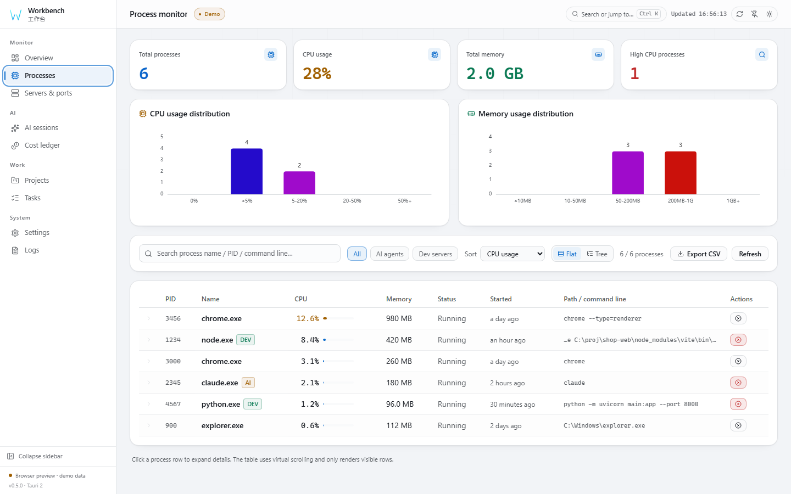
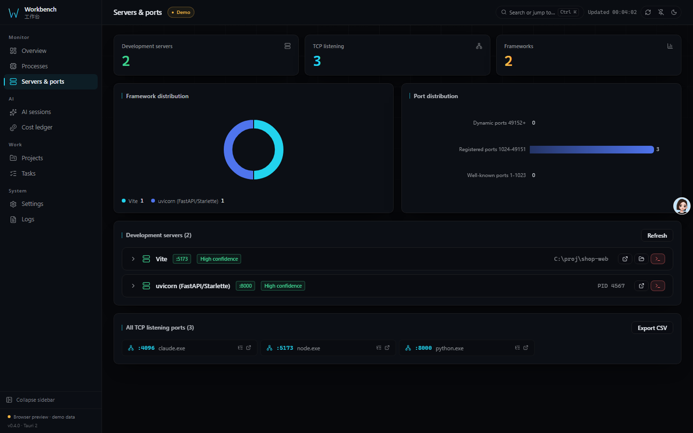
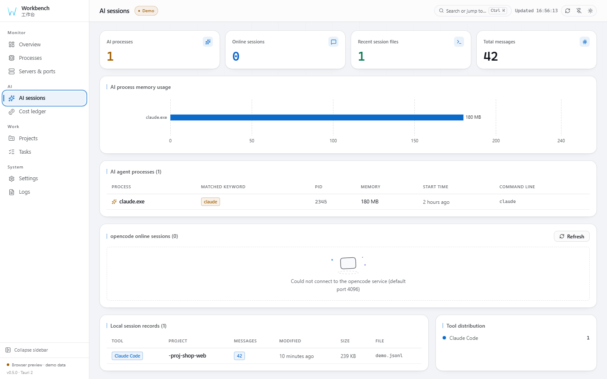
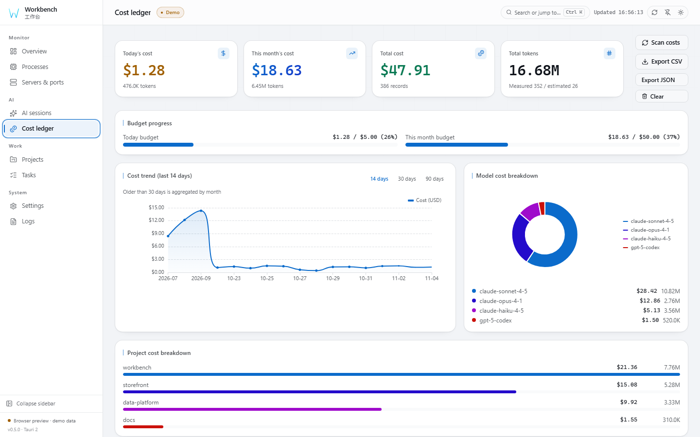
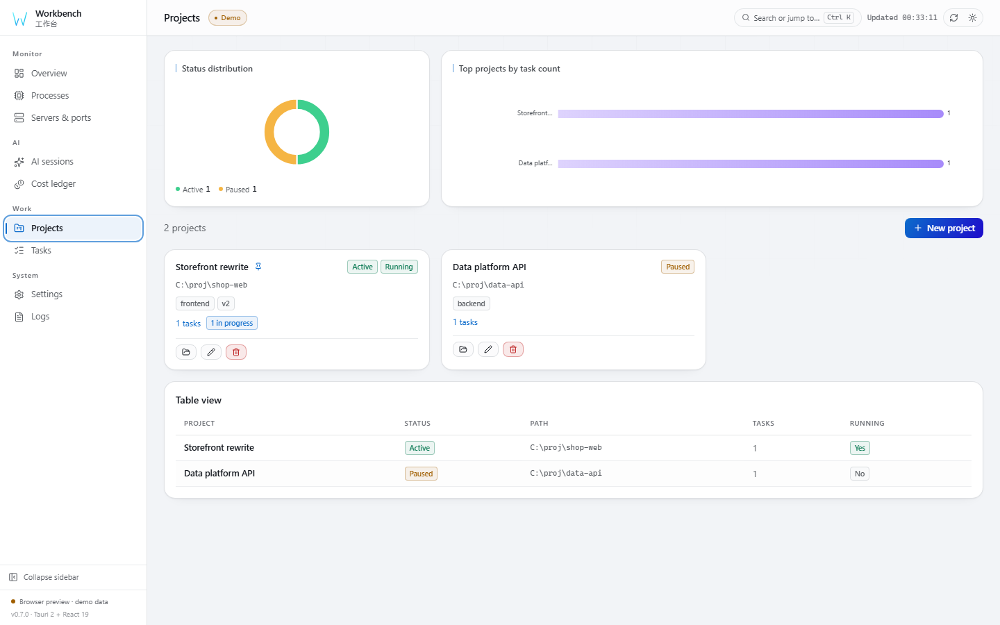
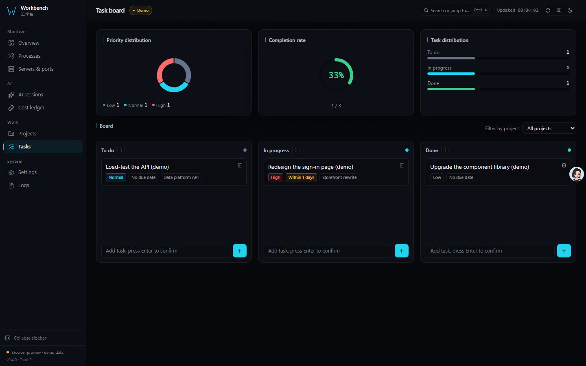
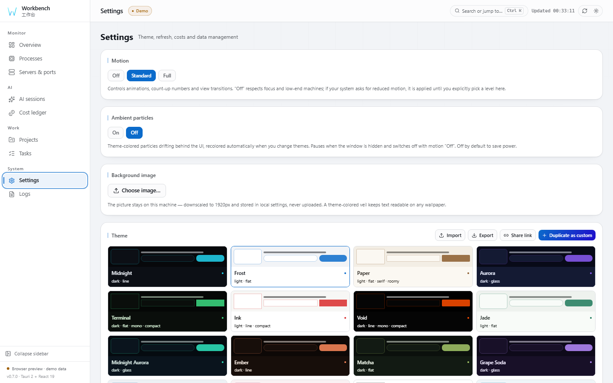
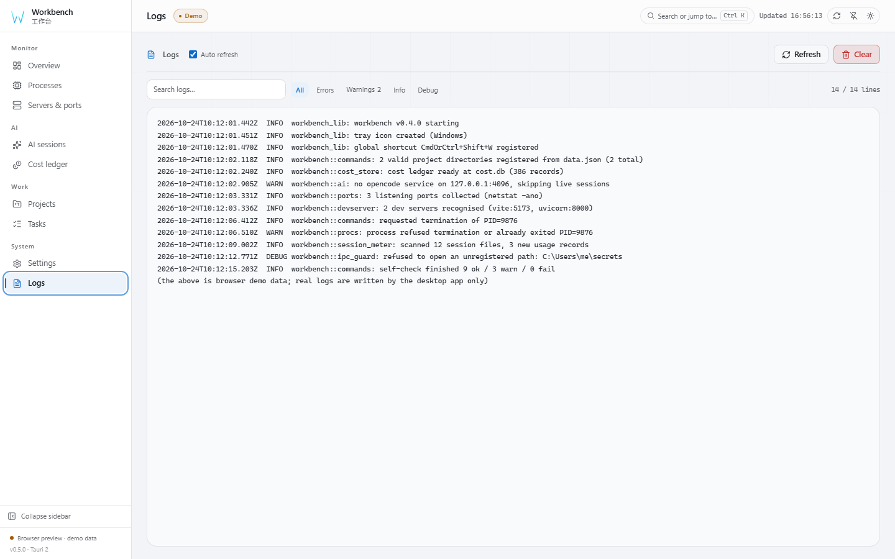

# Architecture & Reference

> Deep-dive reference for Workbench. The README is the showcase; everything
> technical lives here. Also available in
> [简体中文](ARCHITECTURE.zh-CN.md) and [日本語](ARCHITECTURE.ja.md).

## Features

| Module | What it does |
|--------|--------------|
| 🖥 **Overview** | CPU / memory trend charts, disk usage donut, process group stats |
| ⚙ **Processes** | Full snapshot, CPU / memory sorting, virtual scrolling (viewport-only rows), kill with confirmation, AI agent detection |
| 🌐 **Servers & ports** | netstat listener detection, dev-framework tags (Vite / Next / Django…) |
| 🤖 **AI sessions** | opencode online sessions, local Claude / Codex session preview |
| 💰 **Cost metering** | Token usage, daily trends, budget alerts, Anthropic cache pricing |
| 📁 **Projects** | Local project registry, automatic Git branch detection |
| ✅ **Tasks** | Kanban board (drag to change status) |
| ⚙ **Settings** | Theme editor, shell / layout / widget arrangement, refresh interval, budget thresholds, JSON import & export, backup & restore, start at login |
| 📋 **Logs** | Built-in viewer, auto refresh, tail reading |
| ⌨ **CLI** | `workbench ps` / `ports` / `diag`, `--json`, read-only, no window |

## Cost metering

- **Three-level confidence**: measured (API-reported usage) → estimated
  (character heuristic) → zero_pricing
- **40+ model prices built in**; the Cost ledger ships a real price-override editor (edit a unit price, add a model, restore built-in prices; invalid prices reject the whole table)
- **Anthropic cache semantics**: `input_tokens` excludes cache;
  `cache_read_input_tokens` billed at 0.1×, `cache_creation_input_tokens` at 1.25×
- **Day attribution**: measured and estimated rows are bucketed per JSONL-line
  `timestamp` (falls back to the previous day / file mtime when missing), so
  appending to a session never rewrites historical days
- **Unknown models are never priced**: unrecognized models are flagged
  `unknown` and recorded as `zero_pricing` — no invented unit prices
- **Idempotent**: each session file keeps only its latest snapshot (replaced
  whole-group by `file_path`), so re-scans never stack stale rows
- **Estimates can be disabled**: the "include estimated rows" toggle live-updates
  overview / trend / model breakdowns
- **Budget alerts**: system notifications, de-duplicated to avoid nagging
- **Scan scope**: the cost scan covers every session file under
  `~/.claude/projects` and `~/.codex/sessions` (the UI preview shows the
  10 most recent)

## Desktop behavior

- Closing the window hides to tray; tray left-click toggles visibility, the
  tray menu really exits the process
- Global hotkey `Ctrl+Shift+W` toggles window visibility (degrades to a warning
  if the hotkey is taken; startup is never blocked)
- Logs roll per launch (> 5 MB archives to `workbench.log.1`), the Logs page
  reads on demand from the tail
- Killing PID 0/4 and critical system processes (csrss / lsass / services …)
  is rejected outright

## Getting started

### System requirements

| Item | Requirement |
|------|-------------|
| OS | Windows, Linux and macOS have CI jobs; platform-specific verification varies |
| Runtime | Windows needs WebView2 (preinstalled on Windows 11); Linux needs WebKitGTK 4.1; macOS uses the system webview |
| Disk | Depends on the platform and bundle |
| Privileges | No admin required; killing a process needs same-or-higher privileges. If a normal kill fails, it can be retried with one click through UAC elevation (Windows only) |
| Network | None required. The only optional probe is the local opencode service when you open the AI sessions page |

### Install from Releases

Check the [latest release](https://github.com/X33834/workbench/releases/latest)
for available assets. Availability and signing status have not been verified here.

### Build from source

Requires [Node.js](https://nodejs.org/) `^22.22.2 || ^24.15.0 || >=26.0.0` for the locked frontend dependencies,
[Rust](https://www.rust-lang.org/tools/install) ≥ 1.90, and the platform webview runtime.

```bash
npm install
```

Local CI mirror (same steps as `.github/workflows/ci.yml`):

```bash
node scripts/ci-local.mjs          # icon contract → typecheck → lint → format →
                                   # unit → build → Playwright → cargo fmt/test/clippy → IPC drift
node scripts/ci-local.mjs --fast   # skip the visual-regression pass
node scripts/ci-local.mjs --linux  # also try the Linux backend job in Docker
```

Packaged-app E2E (real Tauri window, real IPC). Start the exe with
`WEBVIEW2_ADDITIONAL_BROWSER_ARGUMENTS=--remote-debugging-port=22300`, then:

```bash
node scripts/e2e-desktop.mjs 22300   # data, backup/restore, pricing, start-at-login
node scripts/e2e-io.mjs 22300        # import / export
```

### IPC contract types

Types crossing the IPC boundary are not hand-written in `src/types.ts`; they
are generated from the Rust structs:

```bash
cd src-tauri
cargo test --test export_bindings   # regenerates src/generated/*.ts
```

`src/types.ts` only re-exports; `src/generated/` is the committed contract
snapshot. After changing a Rust struct you must re-run the command above,
otherwise the CI drift gate will reject the PR.

### Command line

The desktop binary doubles as a read-only CLI — useful in scripts, CI and SSH
sessions where opening a 1440×900 window is absurd:

```bash
workbench ps --json      # [{pid, name, cpu, memory, parent_pid, status, cmd_line, …}]
workbench ports          # PROTO PORT ADDRESS STATE PID
workbench diag --json    # the same report the Settings panel renders
```

Exit codes: `0` success, `2` unknown command. It never mutates state.

### Development

```bash
npm run tauri dev      # desktop dev mode (hot reload)
npm run dev            # frontend only, browser demo mode, no Rust needed
```

### Production build

```bash
npm run tauri build
```

Artifacts land in `src-tauri/target/release/bundle/`.

## Tech stack

| Layer | Choice |
|-------|--------|
| Runtime | Tauri 2 (Rust + OS webview) |
| Frontend | React 19 + TypeScript (strict) + Vite 8 |
| State | Zustand 5 (persist) |
| Styling | Tailwind CSS 4 + dual-theme CSS variables |
| Charts | ECharts 6 (tree-shaken, dark/light themes registered) |
| Virtualization | @tanstack/react-virtual 3 (variable-height expanded rows) |
| Subscriptions | Zustand 5 `useShallow` selectors + `memo` page components |
| IPC | Tauri IPC + spawn_blocking |
| Contracts | ts-rs 12 generates `src/generated/*.ts` from Rust structs, CI drift-gated |
| Process data | sysinfo |
| Ports | netstat parser (POSIX / Windows dialects) |
| i18n | 简体中文 default, switchable English / 日本語 |
| Quality gates | ESLint 10 + Prettier 3 + vitest 5 + clippy `-D warnings` |

## Project structure

```
workbench/
├── src/                    # frontend
│   ├── pages/              # 8 feature pages (lazy loaded)
│   ├── lib/                # store / api / echarts / chartTheme / i18n / util
│   ├── generated/          # ts-rs generated IPC contract types (do not edit)
│   ├── ui.tsx              # shared component library
│   ├── types.ts            # type re-exports + frontend-only types
│   ├── App.tsx             # app shell
│   └── styles/global.css   # global styles & theme variables
├── src-tauri/              # Rust backend
│   ├── capabilities/       # Tauri permission set (minimal)
│   ├── icons/              # app icons (generated by scripts/make_icons.py)
│   ├── src/
│   │   ├── commands.rs     # IPC command layer
│   │   ├── procs.rs        # process snapshot + kill
│   │   ├── ports.rs        # netstat parsing
│   │   ├── devserver.rs    # dev-framework detection
│   │   ├── ai.rs           # AI session fetching
│   │   ├── pricing.rs      # model price matching
│   │   ├── session_meter.rs# JSONL token cost parsing
│   │   ├── cost_store.rs   # cost data persistence
│   │   ├── ipc_guard.rs    # IPC argument whitelist
│   │   └── lib.rs          # Tauri bootstrap
│   └── tests/              # IPC contract export test
├── docs/                   # GitHub Pages landing page + screenshots
├── scripts/                # icon & screenshot helper scripts
└── .github/workflows/      # CI / Release / Pages
```

## Development & quality

```bash
npm run format:check       # Prettier
npm run lint               # ESLint (zero warnings)
npm run test               # frontend unit tests (vitest, 370 cases)
npm run coverage           # coverage
npm run dup                # duplication (jscpd, 3% threshold)
npm run build              # tsc + vite build

cd src-tauri
cargo test                 # backend tests + IPC contract export
cargo clippy --all-targets -- -D warnings   # zero-warning gate
```

Pure Rust logic (netstat parsing, framework detection, price matching, token
extraction, JSON storage, IPC guard) carries `#[cfg(test)]` unit tests; the
frontend is covered by vitest (util / store / shared components / error
boundary). CI runs formatting, lint, type check, build, both test suites,
clippy with zero warnings, and verifies `src/generated/` matches the Rust
structs.

## FAQ

<details>
<summary>How is the cost metering computed? Is it accurate?</summary>

It parses the `usage` fields in local Claude Code / Codex session JSONL files
and prices them against 40+ built-in model prices, with three confidence
levels:

- **measured** — real usage reported by the API, most accurate
- **estimated** — no usage, heuristic by character count (can be disabled)
- **zero_pricing** — model unrecognized, recorded as free rather than priced
  with a made-up unit price

Anthropic cache tokens follow the official semantics (read 0.1×,
write 1.25×).
</details>

<details>
<summary>Does it upload my data anywhere?</summary>

No. Projects, tasks, the cost ledger and logs all live in the local app data
directory. The app only does two local things: read `netstat` for ports, and
read local session files for costs. The only optional network call is probing
the local opencode service (default port 4096); on failure it just shows "not
detected".
</details>

<details>
<summary>Can killing a process break my system?</summary>

No. PID 0/4 and critical system processes (csrss, lsass, services…) are
rejected by the backend; the frontend asks for confirmation first; and the
target identity is re-verified after refresh to avoid PID-reuse mistakes.
</details>

<details>
<summary>Where did the window go after I closed it? How do I quit?</summary>

Hiding to the tray is intentional (the app is meant to keep monitoring). Right
click the tray icon and choose "Quit"; the hotkey <code>Ctrl+Shift+W</code>
toggles visibility anytime.
</details>

<details>
<summary>Windows says "Unknown publisher" — what do I do?</summary>

Check the publisher and signing status of the downloaded file before deciding
whether to run it. Release asset availability and signing have not been verified here.
</details>

## Roadmap

Done and planned. Vote or propose new ideas in the Issues.

- [x] Real-time process / port / dev-server monitoring
- [x] AI session cost metering with budget alerts
- [x] Projects & task kanban
- [x] Data-driven themes (8 built-ins + custom editor + import/export), log viewer
- [x] Three shells (rail / top dock / zen) and seven overview layouts
- [x] Draggable, hideable overview widgets
- [x] Multilingual UI (English / 简体中文 / 日本語)
- [x] Cross-platform CI jobs defined for Windows, Linux and macOS
- [ ] Installer code signing (needs a paid certificate)
- [x] Model pricing editor (edit / add / reset overrides from the UI)
- [x] Data backup and restore (timestamped snapshots, one-click rollback)
- [x] SQLite cost ledger (100k records aggregate in 246 ms; sharding not needed)
- [x] Page-level E2E (Playwright 10 pages × 8 themes plus packaged-app suites:
      data/backup and import/export)
- [x] Editable widget widths (4/6/8/12 columns)
- [x] Theme editor: status colours, live contrast readout, UI scale
- [x] Theme share links (theme packed into a URL fragment — opens straight into
      the importer, no backend needed)
- [x] Elevated process termination (UAC prompt after a normal kill fails;
      protected processes are rejected by the backend up front)
- [x] Process tree view (parent/child from `parent_pid`, cycle-safe, virtualised)
- [x] Command palette (Ctrl/Cmd+K over pages, processes, ports, projects, tasks)
- [x] Port → process jump and reverse port lookup in the process detail
- [x] CSV export for processes and listening ports
- [x] Environment self-check with per-item ok / warn / fail and a copyable report
- [ ] Auto-update (needs a signed release channel)

## Known limitations

- Port collection runs `netstat -ano` on Windows and `ss -tulpn` on Linux
  (falling back to `netstat`). CI defines Linux backend checks and a `deb`
  build; platform and release-asset verification must be assessed separately.
- Interaction paths are covered by Playwright (structure and WCAG AA across 10 pages × 8 themes), a structural feature suite for the command palette / process tree / port jump / CSV export, plus a packaged-exe desktop E2E over real IPC
- The cost ledger is a SQLite database (`cost.db`, `rusqlite` bundled) with
  indexes on day / model / file. Aggregation runs inside SQL, so 100k records
  aggregate in ~250 ms instead of re-parsing a whole JSON file per query.
  The old `cost_data.json` is imported once and renamed `.migrated` (never deleted)
- Signing status and availability of release installers have not been verified here
- The tray menu text is bilingual Chinese/English and does not follow the UI
  language switch (it is built once at startup)
- No plugin API, no HTTP API and no remote monitoring — by design, see
  [COMPARISON.md](COMPARISON.md) for what that costs us against Glances and
  System Informer

## Data storage

| File | Purpose | Location |
|------|---------|----------|
| `data.json` | Projects & tasks | app data dir |
| `cost.db` | Cost records + pricing settings (SQLite) | app data dir |
| `pricing_overrides.json` | User price overrides (editable on the Cost ledger page) | app data dir |
| `workbench.log` | Runtime logs | app data dir |
| `*.corrupt-<timestamp>` | Untouched backup of a data file that failed to parse (never overwritten by the next save) | app data dir |

On Windows the app data dir is `%APPDATA%\com.workbench.desktop`.

## Screenshot gallery

All screenshots are captured in **browser demo mode** (`npm run preview`):
outside Tauri the app injects static demo data from `src/lib/demo.ts`; all
paths and host names are placeholders, no real machine data.

| Overview | Processes |
|----------|-----------|
|  |  |
| CPU / memory trends, disks, process groups | Full snapshot, virtual scrolling, kill confirmation |

| Servers & ports | AI sessions |
|-----------------|--------------|
|  |  |
| netstat parsing, dev-framework tags | Session files, live sessions, tool mix |

| Cost ledger | Projects |
|-------------|----------|
|  |  |
| Budget progress, trend, model split, price editor | Local projects, Git branch detection |

| Tasks | Settings |
|-------|----------|
|  |  |
| Drag-and-drop kanban | Theme editor, shell/layout, widgets, backup |

| Logs | Themes |
|------|--------|
|  |  |
| Built-in log viewer, tail reading | Five styles, one token set |

### Visual system

| Brand mark (sidebar) | Brand mark (masthead) |
|----------------------|-----------------------|
|  |  |

The mark is four vector strokes with `currentColor` and no plate — it sits
directly on the panel, on any background.

| Icon at every shipped size | Icon embedded in the exe |
|----------------------------|--------------------------|
|  |  |

| Collapsed sidebar | Narrow screen (drawer) |
|-------------------|------------------------|
|  |  |

### Themes, shells and layouts

Theme is **data, not CSS**: six colours plus six shape knobs expand into 26 CSS
variables and a matching chart palette. Everything below is reachable from
Settings → Appearance, and any built-in theme can be duplicated and edited.

| Orbit layout (Aurora) | Ledger layout (Ink) |
|-----------------------|---------------------|
|  |  |

| Zen layout (Void) | Dense layout (Terminal) |
|-------------------|--------------------------|
|  |  |

| Dock shell | Zen shell |
|------------|-----------|
|  |  |

- **Shell** moves the navigation: left rail, top dock, or a collapsed icon strip.
- **Layout** re-arranges the overview: bento, ledger, orbit, dense, zen.
- **Widgets** can be dragged, reordered and hidden independently of both.

Five styles share one token set (surface, hairline, radius, type scale); they
differ in surface colour, radius, density and type family, not just hue.

See [docs/plan-audit.md](plan-audit.md) for the capability audit and
[docs/audit-2026-10-22.md](audit-2026-10-22.md) for the full
correctness / security / reliability / performance / test-quality review,
including the competitor matrix (Raycast, Datadog, Warp, Linear, Zed) and the
measured coverage / complexity numbers.

Regenerate screenshots yourself: `npm run build`, then `npm run preview`,
then run a headless Chrome with
`--remote-debugging-port=9222`, then `node scripts/shoot_docs.mjs`.
The script asserts demo mode is active and refuses to shoot otherwise, so real
data can never leak into the repo.
