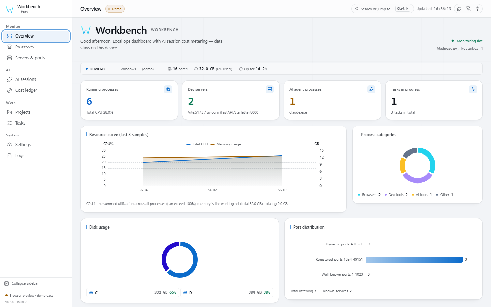
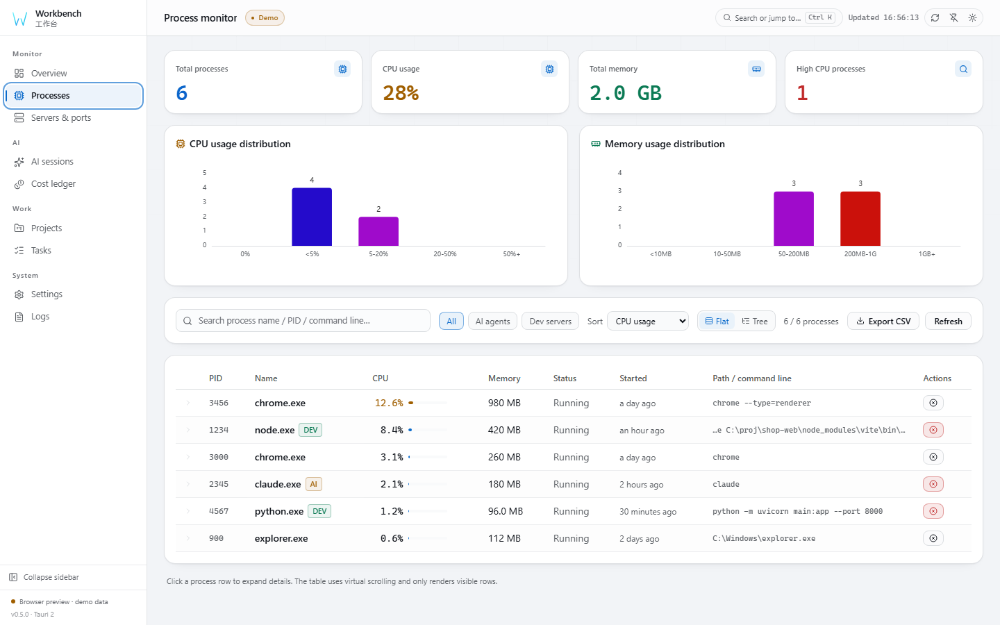
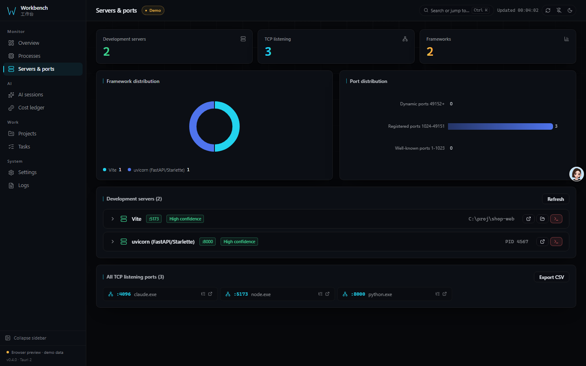
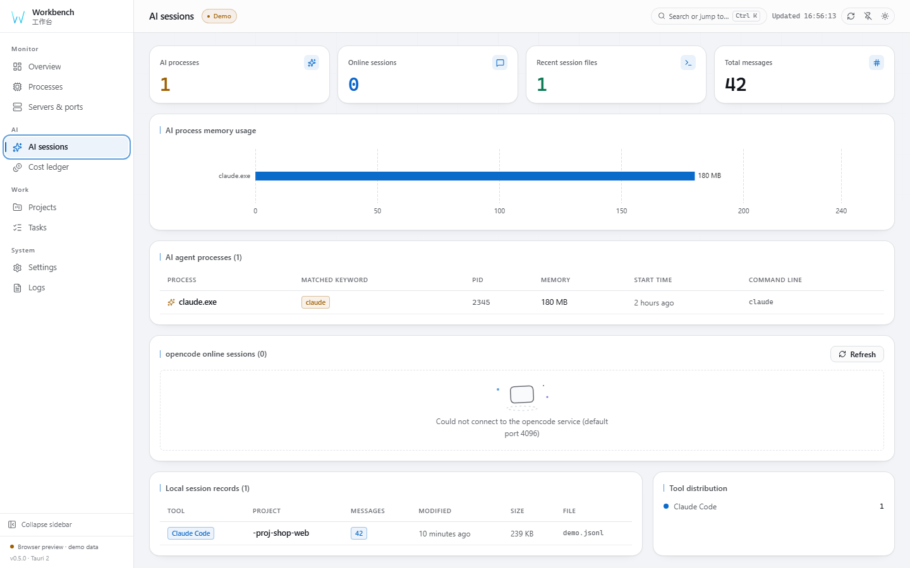
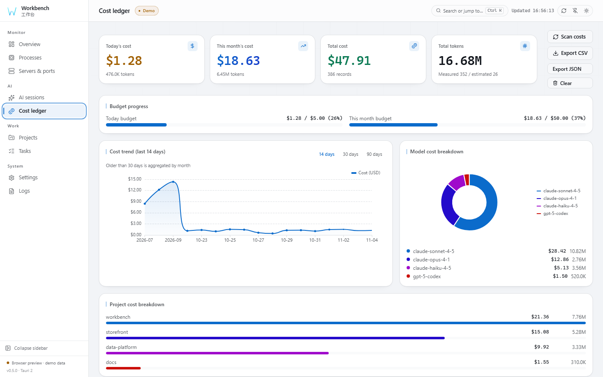
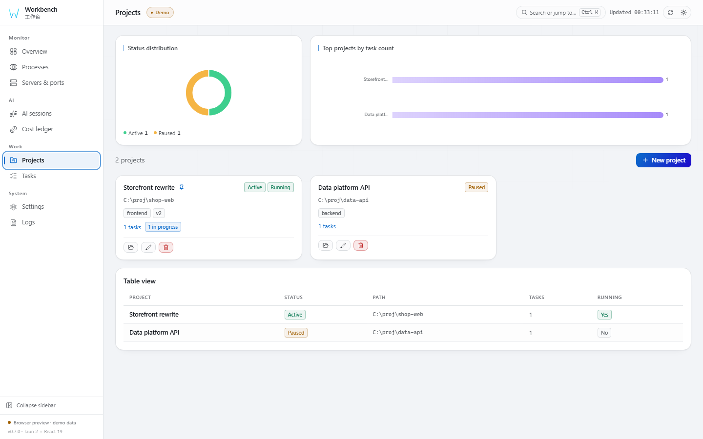
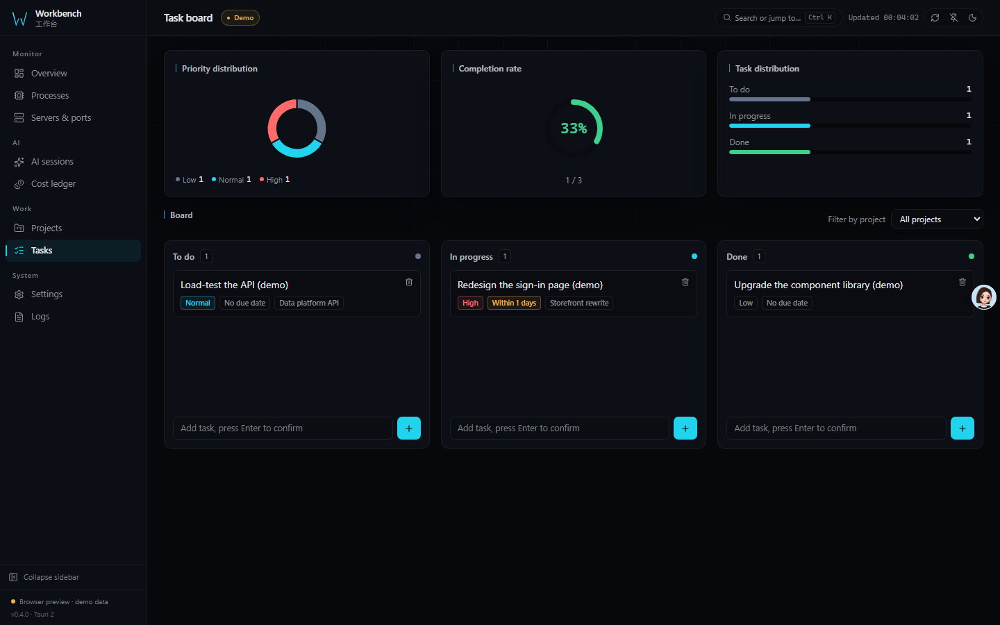
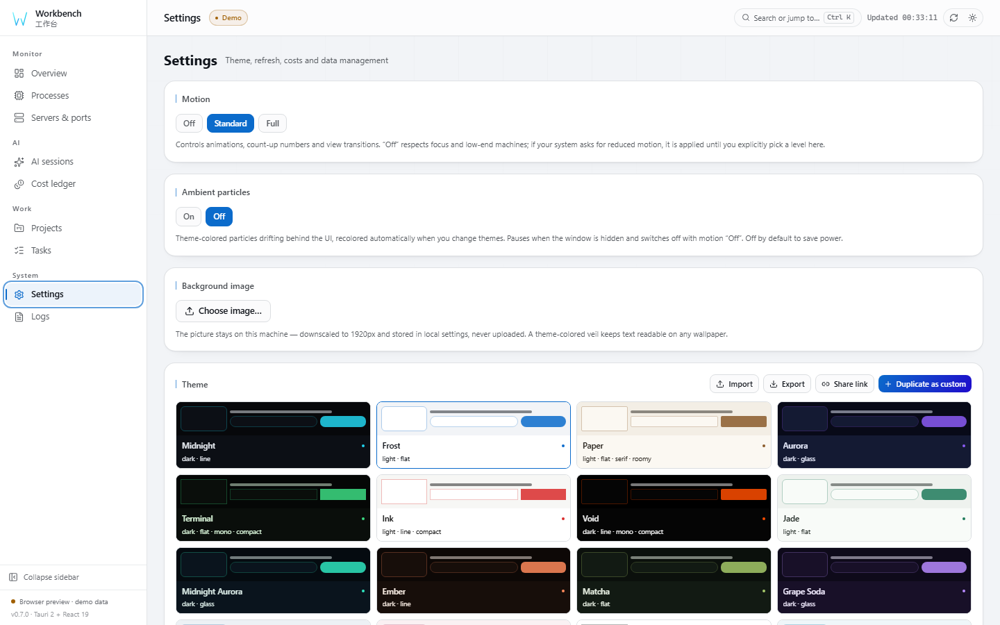
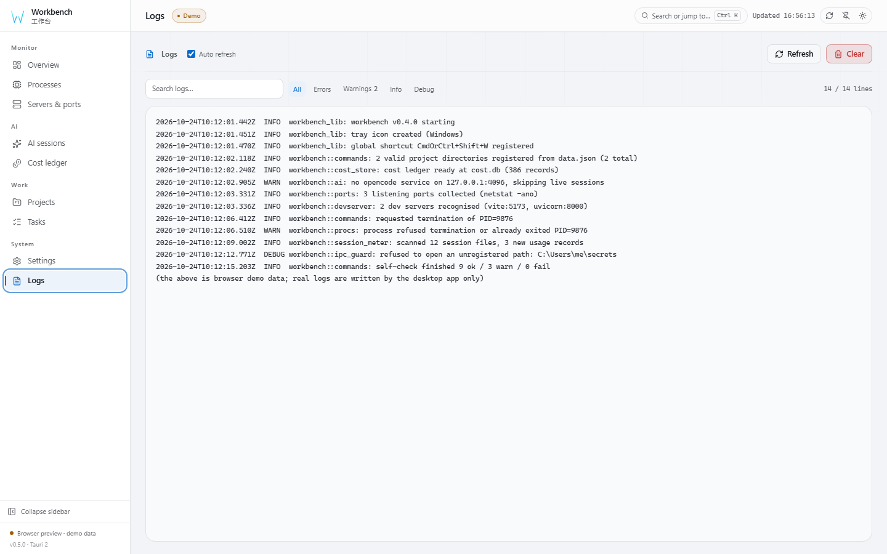

# 架构与参考手册

> Workbench 深度参考文档。README 是橱窗，技术细节都在这里。其他语言：
> [English](ARCHITECTURE.md) / [日本語](ARCHITECTURE.ja.md)。

## 功能概览

| 模块 | 能力 |
|------|------|
| 🖥 **概览** | CPU / 内存趋势图、磁盘占用环形图、进程分类统计 |
| ⚙ **进程** | 全进程快照、CPU / 内存排序、虚拟滚动（只渲染视口内的行）、杀进程二次确认、AI 代理识别 |
| 🌐 **服务与端口** | netstat 端口监听识别、开发框架标注（Vite/Next/Django…） |
| 🤖 **AI 会话** | opencode 在线会话、本地 Claude/Codex 会话预览 |
| 💰 **成本计量** | token 消耗统计、按日/月趋势、预算告警、Anthropic 缓存折扣计价 |
| 📁 **项目** | 本地项目管理、Git 分支自动检测 |
| ✅ **任务** | 看板式任务板（拖拽切换） |
| ⚙ **设置** | 主题编辑器、外壳 / 版面 / 组件摆放、刷新间隔、预算告警、JSON 导入导出、数据备份恢复、开机自启 |
| 📋 **运行日志** | 内置日志查看器、自动刷新 |

## 成本计量

- **三级降级**：measured（API 上报 usage）→ estimated（字符数启发式）→ zero_pricing
- **40+ 模型价格内置**；成本页内置价格覆盖编辑器，可改单价、新增型号、一键恢复内置价（写入 `pricing_overrides.json`，非法价格整表拒绝）
- **Anthropic 缓存语义**：`input_tokens` 不含缓存，`cache_read_input_tokens` 按 0.1×、`cache_creation_input_tokens` 按 1.25× 独立计价
- **按日归属**：measured 与 estimated 记录都按 JSONL 行级 `timestamp` 落到各自那一天（无时间戳时回退上一天 / 文件 mtime 日），会话追加只改最新一天，趋势图不会重写历史
- **未定价不冒充消费**：型号推断失败标 `unknown` 并记为 `zero_pricing`，不会按某个具体型号编造单价
- **幂等且防重复**：每个会话文件在库中只保留最新一组记录（按 `file_path` 整组替换），文件变化不会叠加旧快照
- **估算可关闭**：设置页 `计入估算记录` 开关实时影响总览 / 趋势 / 模型分解聚合
- **预算告警**：系统通知，防重复打扰
- **扫描范围**：成本扫描覆盖 `~/.claude/projects` 与 `~/.codex/sessions` 全部会话文件（UI 预览仍只展示最近 10 条）

## 桌面行为

- 关闭窗口 = 隐藏到托盘；托盘左键切换显示，托盘菜单「退出工作台」真正结束进程
- 全局快捷键 `Ctrl+Shift+W` 切换窗口可见性（被占用时降级为警告，不影响启动）
- 日志按启动滚动（>5MB 归档为 `workbench.log.1`），运行日志页按需尾部读取
- 终止进程对 PID 0/4 与关键系统进程（csrss/lsass/services 等）直接拒绝

## 快速开始

### 系统要求

| 项 | 要求 |
|----|------|
| 操作系统 | CI 定义了 Windows、Linux 和 macOS 任务；各平台验证情况不同 |
| 运行时 | Windows 需 WebView2（Windows 11 预装）；Linux 需 WebKitGTK 4.1；macOS 使用系统 WebView |
| 磁盘 | 取决于平台和安装包 |
| 权限 | 无需管理员权限；进程终止需与目标进程同级权限。普通结束失败后可一键经 UAC 提权重试（仅 Windows） |
| 网络 | 不需联网。仅在你主动使用 AI 会话页时会探测本地 opencode 服务 |

### 从 Release 安装

请在 [最新 Release](https://github.com/X33834/workbench/releases/latest) 查看可用附件。
此处未验证附件的可用性和签名状态。

### 从源码构建

环境要求：锁定的前端依赖需要 [Node.js](https://nodejs.org/) `^22.22.2 || ^24.15.0 || >=26.0.0`，
另需 [Rust](https://www.rust-lang.org/tools/install) ≥ 1.90 和对应平台的 WebView 运行时。

```bash
npm install
```

### IPC 契约类型生成

前端引用的跨 IPC 类型不在 `src/types.ts` 手写，而是由 Rust 结构体生成：

```bash
cd src-tauri
cargo test --test export_bindings   # 重新生成 src/generated/*.ts
```

`src/types.ts` 只做 re-export，`src/generated/` 作为契约快照入库。
改完 Rust 结构体必须重跑上面这条命令，否则 CI 的漂移门禁会直接拦下。

### 开发模式

```bash
npm run tauri dev      # 桌面开发模式（含热更新）
npm run dev            # 仅前端，浏览器演示模式，无需 Rust
```

### 生产构建

```bash
npm run tauri build
```

构建产物位于 `src-tauri/target/release/bundle/`。

## 技术栈

| 层 | 选型 |
|----|------|
| 运行时 | Tauri 2 (Rust + OS Webview) |
| 前端框架 | React 19 + TypeScript（strict）+ Vite 8 |
| 状态管理 | Zustand 5 (persist) |
| 样式 | Tailwind CSS 4 + 双主题 CSS 变量 |
| 图表 | ECharts 6（按需引入 + 暗/亮双主题注册） |
| 虚拟滚动 | @tanstack/react-virtual 3（展开行高度可变，进入视口后实测回写行高） |
| 状态订阅 | Zustand 5 `useShallow` 选择器 + 页面组件 `memo`（自身切片不变不重渲染） |
| IPC 通道 | Tauri IPC + spawn_blocking |
| IPC 契约 | ts-rs 12 由 Rust 结构体生成 `src/generated/*.ts`，CI 校验无漂移 |
| 进程采集 | sysinfo |
| 端口解析 | netstat 解析器（POSIX / Windows 双方言兼容） |
| 多语言 | 简体中文默认，可切换 English / 日本語 |
| 质量门禁 | ESLint 10 + Prettier 3 + vitest 5 + clippy `-D warnings` |

## 项目结构

```
workbench/
├── src/                    # 前端源码
│   ├── pages/              # 8 个功能页面（按需 lazy 加载）
│   ├── lib/                # store / api / echarts / chartTheme / i18n / util
│   ├── generated/          # ts-rs 生成的 IPC 契约类型（勿手改）
│   ├── ui.tsx              # 共享组件库
│   ├── types.ts            # 类型 re-export 与前端专有类型
│   ├── App.tsx             # 主应用入口
│   └── styles/global.css   # 全局样式与主题变量
├── src-tauri/              # Rust 后端
│   ├── capabilities/       # Tauri 权限集（最小面）
│   ├── icons/              # 应用图标（由 scripts/make_icons.py 生成）
│   ├── src/
│   │   ├── commands.rs     # IPC 命令层
│   │   ├── procs.rs        # 进程快照 + 终止
│   │   ├── ports.rs        # netstat 解析
│   │   ├── devserver.rs    # 开发框架识别
│   │   ├── ai.rs           # AI 会话拉取
│   │   ├── pricing.rs      # 模型价格匹配
│   │   ├── session_meter.rs # JSONL token 成本解析
│   │   ├── cost_store.rs   # 成本数据持久化
│   │   ├── ipc_guard.rs    # IPC 入参白名单
│   │   └── lib.rs          # Tauri 启动入口
│   └── tests/              # IPC 契约导出测试
├── docs/                   # GitHub Pages 落地页 + 截图
├── scripts/                # 图标生成与截图辅助脚本
└── .github/workflows/      # CI / Release / Pages
```

## 开发与质量

```bash
npm run format:check       # Prettier 格式检查
npm run lint               # ESLint（零警告）
npm run test               # 前端单测（vitest）
npm run coverage           # 覆盖率（v8）
npm run build              # tsc + vite build
node scripts/ci-local.mjs  # 本地复跑 CI 的全部步骤（--fast 跳过视觉回归）
node scripts/ci-local.mjs --linux   # 额外尝试在 Docker 里跑 Linux 后端 job

# 打包版的端到端（真实 Tauri 窗口 + 真实 IPC），先启动 exe 并带 CDP 端口：
#   WEBVIEW2_ADDITIONAL_BROWSER_ARGUMENTS=--remote-debugging-port=22300 workbench.exe
node scripts/e2e-desktop.mjs 22300  # 数据/备份恢复/定价/开机自启
node scripts/e2e-io.mjs 22300       # 导入 / 导出

cd src-tauri
cargo test                 # 后端单测 + IPC 契约导出
cargo clippy --all-targets -- -D warnings   # 零警告门禁
```

Rust 侧纯逻辑（netstat 解析、框架识别、价格匹配、token 提取、JSON 存储、IPC 守卫）
都有 `#[cfg(test)]` 单测；前端有 vitest 单测覆盖 util / store / 共享组件 / 错误边界。
CI 跑格式、静态检查（含圈复杂度 ≤10、认知复杂度 ≤15）、重复行（jscpd <3%）、
类型检查、构建、两侧单测、Playwright 视觉与对比度回归、clippy 零警告，
并校验 `src/generated/` 与 Rust 结构体一致。同一套步骤在本地用
`node scripts/ci-local.mjs` 一次跑完。

## 常见问题

<details>
<summary>成本计量是怎么算的？准不准？</summary>

解析本机 Claude Code / Codex 会话 JSONL 中的 usage 字段，按内置的 40+ 模型价格计算。
分三级可信度：

- **measured** —— 文件里有真实 usage 上报，最准
- **estimated** —— 无 usage，按字符数启发式估算（可在设置里关掉）
- **zero_pricing** —— 型号无法识别，标为不计费而**不**编造单价

Anthropic 的缓存 token 按官方语义单独计价（读 0.1×、写 1.25×）。
</details>

<details>
<summary>会不会把数据上传到云端？</summary>

不会。项目、任务、成本账本、日志都写在本机 app data 目录。应用只在本地做两件事：
读 `netstat` 看端口、读本机 session 文件算成本。唯一的可选外连是探测本机 opencode
服务（默认 4096 端口），失败只显示「未检测到」，不影响其它功能。
</details>

<details>
<summary>杀进程会误杀系统关键进程吗？</summary>

不会。PID 0/4 与 csrss、lsass、services 等关键系统进程被后端直接拒绝，
前端另有二次确认；终止前会刷新并校验进程身份，避免 PID 复用导致误杀。
</details>

<details>
<summary>关闭窗口后程序去哪了？怎么真正退出？</summary>

隐藏到系统托盘（有意设计，便于常驻监控）。右键托盘图标选「退出工作台」才结束进程；
快捷键 <code>Ctrl+Shift+W</code> 可随时显示 / 隐藏窗口。
</details>

<details>
<summary>Windows 提示「未知发布者」怎么办？</summary>

请在决定是否运行之前检查下载文件的发布者和签名状态。
此处未验证 Release 附件的可用性和签名状态。
</details>

## Roadmap

已完成与计划中的方向。欢迎在 Issues 里投票或提新想法。

- [x] 进程 / 端口 / 开发服务器实时监控
- [x] AI 会话成本计量与预算告警
- [x] 项目与任务管理
- [x] 数据驱动主题（8 套内置 + 自定义编辑器 + 导入导出）、日志查看器
- [x] 三种外壳（侧栏 / 顶部坞 / 专注）与七种概览版面
- [x] 可拖拽、可隐藏的概览组件
- [x] 多语言界面（English / 简体中文 / 日本語）
- [x] 为 Windows、Linux 和 macOS 定义跨平台 CI 任务
- [ ] 安装包代码签名（需付费证书）
- [x] 模型价格编辑器（界面内改价 / 新增 / 恢复内置价）
- [x] 数据备份与恢复（带时间戳快照，一键回滚）
- [x] 成本账本 SQLite（十万条聚合 246ms，无需分片）
- [x] 页面级端到端测试（Playwright 10 页 × 8 主题 + 打包版两套 E2E：数据、导入导出）
- [x] 组件宽度可调（4/6/8/12 栅格）
- [x] 主题编辑器：状态色 + 实时对比度 + 界面缩放
- [x] 主题分享链接（主题压进 URL，打开即导入，无需后端）
- [x] 以管理员结束进程（普通结束失败后触发 UAC 系统授权；受保护进程由后端先行拦截）
- [x] 进程树视图（按 `parent_pid` 归组，对孤儿与环安全，虚拟滚动）
- [x] 命令面板（Ctrl/Cmd+K 覆盖页面、进程、端口、项目、任务）
- [x] 端口 → 进程跳转，以及进程详情里的反向端口列表
- [x] 进程与监听端口的 CSV 导出
- [x] 环境自检（逐项 ok / warn / fail，报告可复制）
- [ ] 自动更新（需发布签名通道）

## 已知限制

- 端口采集在 Windows 使用 `netstat -ano`，在 Linux 使用 `ss -tulpn`（回退 `netstat`）。CI 定义了 Linux 后端检查与 `.deb` 构建；平台和发布附件仍需单独验证
- 交互路径由 Playwright（10 页面 × 8 主题的结构/对比度回归）、命令面板/进程树/端口跳转/CSV 导出的结构化用例，以及打包版桌面 E2E（真实 IPC）覆盖
- 成本账本使用 SQLite（`cost.db`，rusqlite bundled），按日 / 模型 / 文件建索引；聚合在 SQL 内完成，十万条记录约 250ms，而不是每次查询都重新解析整个 JSON。旧 `cost_data.json` 首次启动自动导入并改名为 `.migrated`（不删除）
- 此处未验证 Release 安装包的签名状态和可用性
- 托盘菜单文案为中英双语，且不跟随界面语言切换（启动时构建一次）
- 没有插件 API、HTTP API 与远程监控——这是有意的取舍，代价写在
  [COMPARISON.zh-CN.md](COMPARISON.zh-CN.md) 里

## 数据存储

| 文件 | 用途 | 位置 |
|------|------|------|
| `data.json` | 项目与任务 | `app data dir` |
| `cost.db` | 成本记录 + 定价设置（SQLite） | `app data dir` |
| `pricing_overrides.json` | 用户自定义模型价格覆盖（成本页可编辑） | `app data dir` |
| `workbench.log` | 运行日志 | `app data dir` |
| `*.corrupt-<时间戳>` | 数据文件解析失败时的原样备份（不会被下次保存覆盖） | `app data dir` |

Windows 下 `app data dir` 为 `%APPDATA%\com.workbench.desktop`。

## 截图全览

以下截图截自**浏览器演示模式**（`npm run preview`）：非 Tauri 环境会注入
`src/lib/demo.ts` 的静态演示数据，所有路径均为占位串，不含任何真实机器信息。

| 概览 | 进程监控 |
|------|----------|
|  |  |
| CPU / 内存趋势、磁盘与进程分类 | 全进程快照、虚拟滚动、杀进程二次确认 |

| 服务与端口 | AI 会话 |
|------------|----------|
|  |  |
| netstat 端口识别与开发框架标注 | 会话文件、在线会话、工具分布 |

| 成本账本 | 项目管理 |
|----------|----------|
|  |  |
| 预算进度、趋势、模型分解、价格覆盖编辑器 | 本地项目、Git 分支检测、卡片/表格双视图 |

| 任务看板 | 设置 |
|----------|------|
|  |  |
| 拖拽看板，待办 / 进行中 / 已完成 | 主题编辑器、外壳/版面、组件管理、备份 |

| 运行日志 | 五套风格 |
|----------|----------|
|  |  |
| 内置日志查看器，按需尾部读取 | 共用一套 token，差异在底色、圆角、密度与字体家族 |

### 视觉体系

| 品牌字形（侧栏） | 品牌字形（报头） |
|------------------|------------------|
|  |  |

字形是四条矢量描边、`currentColor`、没有底板——直接贴在面板上，任何底色都不会
出现白片。

| 各尺寸图标 | 打进 exe 的图标 |
|------------|-----------------|
|  |  |

| 折叠侧栏 | 窄屏抽屉 |
|----------|----------|
|  |  |

### 主题、外壳与版面

主题是**数据而不是 CSS**：六个颜色加六个形状旋钮，展开成 26 个 CSS 变量和配套图表色板。
下面这些都在「设置 → 外观」里，任何内置主题都能复制后随意改。

| 环仪版面（Aurora） | 账本版面（Ink） |
|--------------------|-----------------|
|  |  |

| 极简版面（Void） | 密排版面（Terminal） |
|------------------|----------------------|
|  |  |

| 顶部坞外壳 | 专注外壳 |
|------------|----------|
|  |  |

- **外壳**决定导航在哪：左侧栏 / 顶部坞 / 图标条。
- **版面**重排概览页：便当格 / 账本 / 环仪 / 密排 / 极简。
- **组件**可以拖拽排序、逐个隐藏，与外壳和版面相互独立。

完整的能力审计（含「声明了但从未生效」的功能清单）见
[docs/plan-audit.md](plan-audit.md)；全维度审查（正确性 / 安全 /
可靠性 / 性能 / 测试有效性，含 Raycast、Datadog、Warp、Linear、Zed 对标矩阵
与实测覆盖率、复杂度数字）见
[docs/audit-2026-10-22.md](audit-2026-10-22.md)。

截图可自行重生（需先 `npm run build` 并启动 `npm run preview`，另开一个
`chrome --headless=new --remote-debugging-port=9222`，然后
`node scripts/shoot_docs.mjs`）。脚本内置演示模式断言，页面未出现演示标记时
直接拒绝截图，避免把真实数据写进仓库。
